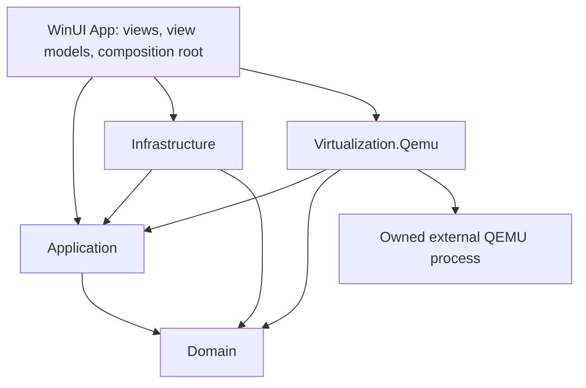

# UTM4WIN Architecture and Development Plan

Status: proposed, awaiting user review. Planning is authorized; implementation is not.
Evidence reviewed: 2026-10-12. No milestone involving implementation has been completed.

## 1. Product goal and scope

Build an independent Windows 11 VM manager in C# and .NET 10 using native WinUI 3, Windows App SDK and MVVM. Preserve the usefulness of UTM's guided VM creation, library and lifecycle controls while adopting Windows conventions and original assets. Rider remains the development IDE. No upstream source or branding is copied.

The recommended first backend is an external QEMU process with WHPX for compatible guests and explicitly selected TCG emulation where appropriate. This is a provisional architecture: the selected Windows QEMU build, display integration and toolchain must pass milestone M0 before becoming implementation commitments.

The first usable release targets Windows 11 x64 hosts and an x86_64 Linux guest. It includes VM creation from a user-supplied ISO, a managed qcow2 disk, configuration editing while stopped, user-mode networking, guest display and input, pause/resume, shutdown, explicit force stop, persistence and actionable errors. Windows guests are a subsequent compatibility milestone. Do not advertise Windows 11 guest support before validating UEFI, Secure Boot, vTPM and guest drivers.

Deferred: Windows on ARM64, additional emulated architectures, snapshots, suspend-to-disk, shared folders, clipboard, audio, USB redirection, bridging, remote access, guest automation, galleries and a Hyper-V management backend. GPU passthrough, gaming-grade 3D and macOS guest installation are outside the initial roadmap. No promise of full UTM feature parity.

UTM's public positioning distinguishes virtualization from slower cross-architecture emulation and provides separate QEMU and Apple Virtualization paths. This is product context, not proof of Windows compatibility. [UTM website](https://mac.getutm.app/), [upstream repository](https://github.com/utmapp/UTM).

## 2. Repository and development environment evidence

Read-only inspection established:

| Item | Observed result | Consequence |
| --- | --- | --- |
| `UTM4WIN.sln` | Solution with configuration sections and no projects | No application build or test is currently meaningful |
| `PLAN.md` | Absent before this planning task | This document is the first proposed roadmap |
| `reference/UTM-main/` | Local Swift/Objective-C UTM source is present | Use this copy without downloading or executing it |
| `dotnet --info` | x64 .NET host/runtime 8.0.21; no SDK found by this installation | .NET 10 SDK setup is required before implementation |
| PATH lookup | `qemu-system-x86_64`, `qemu-img`, `msbuild` not found | Availability elsewhere is unknown; do not claim they are absent system-wide |
| Standard Windows SDK include path | No entries returned | Windows SDK installation and location remain unverified |
| Host OS via CIM | Windows 11 Pro, build 26200, 64-bit | Only this development host was inspected |
| CPU via CIM | AMD; firmware virtualization reports true; SLAT reports false | These flags alone cannot establish WHPX readiness; reconcile with WHP capability checks and a boot experiment |

Windows Hypervisor Platform feature state, effective hypervisor availability, Windows App Runtime installation, Rider version and Build Tools components have not been verified. No QEMU binary was run, no VM booted and no dependency installed. Existing staged and unstaged user changes were present before this task and must remain untouched.

## 3. Local UTM implementation findings

All paths below are relative to `reference/UTM-main/`. Findings refer to inspected implementation sections of this local copy, not an assumed upstream release. A source commit identifier is not established for the downloaded directory.

| Inspected path and symbol | Actual implementation finding | Classification and Windows implication |
| --- | --- | --- |
| `Services/UTMVirtualMachine.swift`: `UTMVirtualMachine`, `UTMVirtualMachineCapabilities`, `UTMVirtualMachineState`, `UTMVirtualMachineStopMethod` | Common async lifecycle contract, explicit capability flags, transitional states, and separate request/force/kill stop modes | UTM application logic; adopt the principles in independent C# contracts |
| `Services/UTMQemuVirtualMachine.swift`: `_start(options:)`, `start(options:)` | Configures resources, optional software TPM and SPICE/interface, starts QEMU, restores resources, then continues boot; failed start kills the owned VM and resets state | UTM orchestration over QEMU; design startup as an owned, reversible resource acquisition sequence |
| Same file: `stop(usingMethod:)`, `determineSnapshotSupport()` | Requested shutdown calls the monitor; snapshot support rejects specific accelerator/device combinations, including disposable mode, GL displays and NVMe | QEMU behavior filtered by UTM policy; neither shutdown success nor snapshot support can be inferred from command acceptance |
| `Services/UTMQemuSystem.m`: `startQemu`, `didLoadDylib:`, `startQemuWithCompletion:` | Resolves `qemu_init`, `qemu_main_loop`, `qemu_cleanup` dynamically and launches the architecture-specific softmmu component through UTM's process abstraction | Apple-specific QEMU integration; this is not evidence that stock Windows QEMU is a drop-in library |
| `Configuration/UTMQemuConfiguration.swift`: `CodingKeys`, `init(from:)` | Typed system, drive, display, network and sharing sections; rejects wrong backend and unsupported configuration versions | UTM configuration logic; use versioned JSON and explicit migrations on Windows |
| `Configuration/UTMQemuConfiguration+Arguments.swift`: `spiceArguments` | Constructs SPICE arguments and a monitor chardev; local QMP is carried through a SPICE port, remote mode uses a pipe | QEMU plus UTM transport choice; keep Windows control and display independent |
| `Services/UTMSpiceIO.m`: `initializeSpiceIfNeeded`, `startWithError:` | Uses CocoaSpice connections, display/input channels, optional audio and clipboard, Unix sockets or remote TLS | SPICE functionality with Apple client integration; CocoaSpice is not a WinUI client |
| `Services/UTMQemuSnapshotBackend.swift`: `snapshotImageURLs`, `UTMQemuLiveSnapshotBackend`, `UTMQemuFrozenSnapshotBackend` | Live operations use the monitor; stopped-image operations use qemu-img; tracks all participating disks and UEFI variables and detects incomplete inventories | UTM snapshot orchestration over QEMU; multi-resource consistency needs a separate design and recovery policy |
| `Services/UTMAppleVirtualMachine.swift`: `_requestStop`, `_forceStop`, `validateGuestProvisioning` | Calls `VZVirtualMachine` APIs on a VM queue; macOS guest provisioning is OS- and architecture-gated | Apple Virtualization Framework; no direct Windows equivalent or planned port |
| `Platform/Shared/VMWizardState.swift`: `VMWizardPage`, `VMWizardState` | Explicit wizard pages, history and OS/boot/hardware options, separate virtualization and Apple-backend choices | UTM workflow plus Apple-specific branches; build Windows guest profiles and capability-aware steps |
| `Platform/UTMData.swift`: `create`, `clone`, `export` | Creates and saves before library insertion; cloning changes UUID and optionally MAC; export removes an existing destination before copying | UTM library workflows; implement independent identity handling and explicit overwrite checks, not upstream replacement behavior |
| `Services/UTMRegistry.swift`: `entry(for:)`, registry initialization | UUID-keyed host registry with observation and debounced serialization | UTM host-specific persistence; separate portable VM configuration from local library/UI metadata |
| `LICENSE` | Apache License 2.0 text | Covers the inspected upstream license file; it does not establish licensing for every dependency or asset |

Architecture lessons: capability-driven UI, explicit state transitions, separation of portable and host-specific data, safe startup cleanup, and separate live/offline image operations. SwiftUI, AppKit, security-scoped bookmarks, Metal, CocoaSpice and VZ APIs require independent Windows designs. The inspected application imports QEMUKit components; their internal QMP implementation was not established by these reads and is not asserted here.

## 4. Backend decision and feature feasibility

| Candidate | Advantages | Constraints | Recommendation |
| --- | --- | --- | --- |
| QEMU + WHPX | Hardware acceleration with QEMU devices and control protocol | Depends on host capability, guest architecture, build options and device compatibility | Primary candidate; validate in M0 |
| QEMU + TCG | Software emulation, including different guest architectures | Substantially different performance; guest/device profiles still need tests | Explicit alternative; no silent fallback |
| Hyper-V VM management | Windows-managed VMs and platform integration | Role/edition requirements, different storage/control/display model; no general cross-ISA emulation | Deferred backend if user demand justifies it |
| Direct WHP API VMM | Fine-grained control | Requires a VMM, devices, firmware, disk/network/display implementation | Rejected for initial scope |
| Apple Virtualization Framework | Relevant to the reference app | Apple platform API | Not a Windows backend |

WHPX is QEMU's accelerator using Windows Hypervisor Platform; it is distinct from managing Hyper-V VMs. QEMU's current master documentation describes x86_64 and ARM64 hosts; ARM64 has specific Windows update requirements. Installed release binaries may lag master. [QEMU WHPX documentation](https://www.qemu.org/docs/master/system/whpx.html).

The Hyper-V role is unavailable on Windows Home; this must not be used as a blanket conclusion about WHP availability. Edition-specific WHP support is a test item, including Windows 11 Home if offered as a supported host. [Microsoft Hyper-V installation requirements](https://learn.microsoft.com/en-us/windows-server/virtualization/hyper-v/get-started/install-hyper-v?pivots=windows).

Proposed compatibility policy:

| Host / guest | Execution policy | Release status |
| --- | --- | --- |
| x64 / x86_64 Linux | WHPX preferred after runtime proof; user-selected TCG alternative | Initial qualification target |
| x64 / x86_64 Windows | Same accelerator policy; qualified firmware/TPM/driver profile required | M6 |
| x64 / ARM64 or other ISA | TCG with an architecture-specific QEMU binary and guest profile | Deferred |
| ARM64 / ARM64 | Investigate WHPX with supported OS updates and matching QEMU build | Future host milestone |
| ARM64 / x86_64 | TCG candidate, not x86 WHPX acceleration | Deferred |

Capability detection combines OS/build/architecture, WHP runtime availability, selected executable identity/version, compiled accelerators/devices/display backends, and an actual disposable boot test. A help listing proves compilation support, not operational acceleration. Avoid reducing security mitigations to gain speed. Report the chosen execution mode before start.

## 5. Modular architecture and proposed solution structure

Create these directories/projects only in their approved milestones:

```text
src/
  UTM4WIN.Domain/                 net10.0
  UTM4WIN.Application/            net10.0
  UTM4WIN.Infrastructure/         net10.0-windows...
  UTM4WIN.Virtualization.Qemu/    net10.0-windows...
  UTM4WIN.App/                    net10.0-windows...; WinUI 3 x64
tests/
  UTM4WIN.UnitTests/
  UTM4WIN.IntegrationTests/       Windows; explicitly opt-in QEMU tests
```

Use a pinned Windows TFM/SDK and minimum supported OS determined in M0. The current Microsoft quickstart includes .NET 10 WinUI targets, but compatibility must be established with a stable Windows App SDK package and the actual toolchain. [Microsoft WinUI quickstart](https://learn.microsoft.com/en-us/windows/apps/get-started/start-here?tabs=stable), [Windows App SDK release channels](https://learn.microsoft.com/en-us/windows/apps/windows-app-sdk/release-channels).



The App references concrete adapters only to register dependencies. View models consume application use cases. Domain references no UI, process, logging package or QEMU implementation. Application defines ports; Infrastructure and Virtualization.Qemu implement them and do not depend on each other. Use standard .NET facilities within each adapter rather than introducing a shared catch-all project.

Responsibilities:

- Domain: VM identity, strongly typed configuration, architecture and execution mode, disk ownership, capabilities, validation and lifecycle rules.
- Application: create/edit/start/pause/resume/shutdown/remove use cases, per-VM operation serialization and session coordination.
- Infrastructure: JSON repository, library index, atomic writes, paths, host diagnostics, log storage and approved OS integration.
- Virtualization.Qemu: executable qualification, guest profiles, deterministic argument generation, process/job lifetime, QMP and qemu-img operations.
- Presentation: Fluent navigation, forms, session views, progress and errors; thread dispatch and rendering adapters remain UI concerns.

Initial ports: `IVmRepository`, `IHostCapabilitiesService`, `IVirtualizationBackend`, `IVmSession`, `IDiskImageService`. Add display contracts at M0/M5 only to the granularity the chosen integration requires. `IVmSession` owns async lifecycle commands, observed state and disposal. Capabilities carry availability and explanatory reasons per feature/configuration; do not use a single global boolean for snapshot support.

Use CommunityToolkit.Mvvm observable state and asynchronous commands in view models, standard Microsoft DI and structured `ILogger` logging. Toolkit cancellation aids UI coordination but does not itself undo backend side effects. [MVVM Toolkit](https://learn.microsoft.com/en-us/dotnet/communitytoolkit/mvvm/), [async command generation](https://learn.microsoft.com/en-us/dotnet/communitytoolkit/mvvm/generators/relaycommand).

Do not introduce plugins, a background Windows service, an event bus, database or a separate contracts assembly until a concrete approved requirement needs them. UI code-behind is limited to view/rendering/window integration.

## 6. VM configuration and persistence

Proposed VM directory: `<chosen library root>/<vm-id>/vm.json`, `disks/`, and per-VM writable firmware variables where required. Host library index, preferences and bounded logs live under the user's local application data. Names are presentation metadata; renaming does not rename the storage directory.

`vm.json` contains schema version, UUID, backend/profile identifier, guest ISA, machine version, execution mode, vCPU count, memory in MiB, firmware references, typed storage/network/display settings and resource ownership. Store portable owned-resource paths relatively; explicitly referenced external images/ISOs remain external. Do not store process IDs, live state, QMP channels, passwords or UI geometry as portable configuration.

Validation checks host/profile compatibility, sensible CPU/memory/disk bounds, image format and access, duplicate resource IDs/MACs, reserved Windows names, missing ISO/firmware and conflicting host ports. For paths inside the VM root, reject traversal, aliases and reparse-point escapes; preserve externally referenced files and follow explicit ownership rules. Detect backing chains and reject unsupported external dependencies rather than importing them silently.

Write configuration to a temporary sibling, flush and replace under a per-VM lock; keep a recoverable previous version. Do not assume replacing configuration and updating the library index is one atomic operation. Reconcile UUID-keyed entries at startup, recognize incomplete creation, and retain artifacts needing recovery. Unknown newer schemas open read-only or fail clearly; migrations preserve originals and never silently downgrade.

Editing creates a draft and checks for conflicting changes at save. MVP hardware editing is stopped-only. Register a new VM only after its files and configuration are committed. Cancellation cleans up only artifacts created by that operation with proven ownership. Removal from the library and deletion of owned data are separate user actions; disk deletion requires explicit authorization and stopped/unowned-session verification.

## 7. QEMU process lifecycle and QMP

One external QEMU process per running VM. Use a validated absolute executable path, a controlled working directory, `UseShellExecute=false`, and `ProcessStartInfo.ArgumentList`. Never pass user-defined shell strings. Shell-safe argument separation does not replace escaping QEMU's own option syntax: file names containing commas need explicit handling. Guest profiles select supported devices and image formats, not arbitrary extra arguments. [QEMU invocation syntax](https://www.qemu.org/docs/master/system/invocation.html).

Proposed ownership: assign each child to a Windows Job Object with kill-on-close and retain its handle for the session. Validate nested-job behavior, child helpers, and the launch-to-assignment race in M0; suspended native process creation is justified only if needed to guarantee assignment before execution. Job close is abrupt termination, so normal app exit first offers guest shutdown/cancel and explicit force-stop confirmation. No detached background VM mode in MVP. [Microsoft Job Objects](https://learn.microsoft.com/en-us/windows/win32/procthread/job-objects).

Preferred control transport to prove in M0 is dedicated redirected stdio for QMP, with guest serial routed elsewhere and diagnostics on stderr. Do not multiplex HMP, guest console and QMP. This avoids exposing a monitor network listener. If the selected binary cannot support reliable isolated stdio, evaluate a user-restricted local transport; named-pipe behavior and ACLs must be verified rather than assumed. Unauthenticated TCP is not an accepted production control fallback.

QMP protocol handling: greeting, `qmp_capabilities`, unique request IDs, one bounded asynchronous reader, serialized writes, correlated responses/errors and separately delivered events. Support fragmented/coalesced messages, bounded payloads, timeouts and disconnects. Canceling a request does not prove QEMU canceled the command; reconcile state before reporting an outcome. [QMP specification](https://www.qemu.org/docs/master/interop/qmp-spec.html).

Supported initial commands are `query-status`, `stop`, `cont`, `system_powerdown` and `quit`, discovered against the selected binary's supported commands. `system_powerdown` requests guest cooperation; its successful response does not prove shutdown. `quit` ends QEMU without promising a clean guest filesystem. Wait for process exit before declaring the VM stopped and freeing resources. [QMP command reference](https://www.qemu.org/docs/master/interop/qemu-qmp-ref.html).

Proposed state transitions:

| Trigger | Transition | Completion evidence / failure handling |
| --- | --- | --- |
| Start | Stopped → Starting → Running | Owned process plus negotiated QMP and observed running status; unwind resources on failure |
| Pause | Running → Pausing → Paused | Backend status/event reconciliation |
| Resume | Paused → Resuming → Running | Backend status/event reconciliation |
| Requested shutdown | Running → Stopping → Stopped | Guest shutdown followed by process exit; timeout offers continue waiting or explicit force stop |
| Guest shutdown / process exit | Active state → Stopped or Faulted | Exit classification and diagnostic context |
| QMP lost while process lives | Active state → Disconnected | Preserve ownership and disk exclusion; reconnect if transport permits, otherwise offer owned force stop |
| Start canceled | Starting → Stopped or Faulted | Cleanup must finish and process exit be verified |

Serialize conflicting commands per VM; events and exit notifications use the same state reducer. A failed/disconnected label never grants permission to modify disks while a process may still own them. Keep last failure separate from configuration. Do not replay destructive commands automatically. On startup, persisted session metadata is diagnostic only: a PID without executable/start-time/ownership verification must never be killed.

## 8. Storage, networking and guest integration

### Storage and firmware

Use qcow2 for newly created managed disks; raw images are an explicit compatibility option. Invoke the qualified qemu-img via structured arguments for offline creation/information/conversion only when the operation is supported and approved. Never mutate or repair an image in use; qemu-img warns that this can destroy it. [qemu-img documentation](https://www.qemu.org/docs/master/tools/qemu-img.html).

MVP creates disks at new destinations without overwrite and boots a read-only ISO. Keep per-VM UEFI variable stores separate from read-only firmware code. Firmware origin, version, architecture and license are part of the validated profile. Growing, converting and repairing existing disks are later workflows; shrinking is excluded initially. Cancellation of long storage operations preserves the source and identifies incomplete destinations.

Snapshots are M7 research, not an MVP guarantee. Distinguish offline disk snapshots, live crash-consistent disk snapshots, guest-quiesced snapshots and complete RAM/device saved state. A restore may require coordinated disks, firmware variables and TPM state. WHPX migration/save-state/device compatibility must be tested on the exact build. Multi-disk qemu-img operations are not a transaction. Require locks, preflight, backup/recovery strategy, an operation journal and explicit destructive restore approval. Do not call a snapshot a backup.

### Networking

MVP uses QEMU user-mode NAT when built with the necessary backend; optional port forwarding binds loopback by default. This avoids requiring a host bridge or privileged TAP configuration. Validate DNS, outbound connectivity, collision reporting and guest-access limitations on the chosen build. Host network changes are separate approved operations. QEMU documents user networking and explicit forwarding bindings. [QEMU networking options](https://github.com/qemu/qemu/blob/master/docs/system/invocation.rst).

Bridging, TAP drivers and Hyper-V switch integration remain deferred, with independent privilege, installation and firewall decisions. Networking enabled in a guest is not a security sandbox guarantee.

### Guest display and input: critical M0 decision

WinUI 3 hosts the application UI, but does not provide a QEMU display client. Keep display failure independent from VM process/control state. Compare these options using a real selected Windows build:

| Option | Usefulness | Main cost / gate |
| --- | --- | --- |
| External QEMU native display | Fast route to prove guest boot/input | Separate window; temporary M0/M4 tool, does not satisfy final integrated-display acceptance |
| Embedded VNC/RFB client | Potential minimal framebuffer/input integration | Must qualify a maintained compatible client, encodings, authentication, DPI, keyboard layouts and rendering cost |
| Native SPICE client via Windows interop | Potential richer guest integration | Windows server/client build availability, native ABI, packaging and licenses; no CocoaSpice reuse |
| RDP into installed guest | Useful later for enhanced sessions | Requires guest support/setup; cannot replace firmware/installer display |

Provisional MVP preference: embedded VNC framebuffer and input if the dependency/build spike passes; otherwise present the SPICE findings for user decision before M5. No library has been selected or approved. Do not write a general-purpose RFB/SPICE stack from scratch merely to avoid dependency review. Do not embed an external QEMU window by reparenting its HWND as the default design.

VNC is not automatically secure because it binds localhost; other local principals may reach it. Verify the selected client/server's compatible authentication and protected transport; do not rely on legacy VNC password authentication as strong security. No LAN listener or WebView/noVNC stack in MVP. [QEMU VNC security documentation](https://github.com/qemu/qemu/blob/master/docs/system/vnc-security.rst).

Input acceptance includes key down/up tracking, release on focus loss, absolute/relative pointer modes where supported, cursor capture/release, keyboard layouts, special-key actions and DPI-aware coordinate mapping. Use bounded frame queues, drop obsolete frames, decode away from the UI thread and measure allocations before considering native GPU rendering.

Clipboard and shared directories are opt-in future capabilities requiring guest-side support and a separate trust boundary. Audio and USB depend on actual client/build/device capabilities. Windows 11 guests require a qualified software TPM implementation and firmware configuration; do not assume swtpm availability from its use in macOS UTM or bypass guest security requirements.

## 9. UI and user workflows

WinUI library page: VM list, search, status and an accessible details pane. Show useful empty/error/loading states, execution mode and unavailable-feature reasons. Use native Fluent controls and original icons, light/dark/system themes, keyboard navigation, screen-reader labels and high-contrast support.

Creation flow: guest profile → supported execution mode → ISO → CPU/memory → managed disk destination/size → network → review. Show required capabilities before creating files. Validate each step and the final draft; allow backward navigation and cancel without discarding existing data.

Session window: display surface, pause/resume, guest shutdown, explicit force stop and input-release action. Separate connecting display from starting guest and from booting guest OS. Show a VM can still be running while display is disconnected. Do not label a QEMU process as a fully booted guest without guest-level evidence.

Settings group hardware, storage, network and integration features. Disable unsafe edits during active sessions. Error dialogs include a short cause, a suggested action and a correlation ID with an optional redacted diagnostic view. Do not expose raw implementation details in normal creation steps.

Use UI-thread dispatch only for bound state/rendering. I/O and virtualization stay asynchronous. VM actions use the same application rules whether triggered from a button or another future entry point.

## 10. Dependencies, distribution and licensing gates

| Component | Proposed use | Approval / evidence gate |
| --- | --- | --- |
| .NET 10 / Windows SDK / Windows App SDK | Required fixed stack | Pin stable versions and verify local build/start in M0; installation separately authorized |
| CommunityToolkit.Mvvm | Observable properties and commands | Microsoft-maintained toolkit; MIT license; verify selected package assets/generators with .NET 10 |
| Microsoft DI/logging packages | Composition and diagnostics | Select compatible .NET 10 versions; review exact packages and transitive notices |
| Test framework | Unit/integration verification | Choose one maintained .NET 10-compatible framework in M1; avoid extra assertion/mocking packages without need |
| QEMU and qemu-img | External VM engine and disk tool | User-supplied trusted build initially; provenance, features, version and dependencies recorded |
| Display client | Embedded guest console | Decision and license/maintenance evidence required in M0 before installation |
| UEFI, guest drivers and software TPM | Guest compatibility | Separate provenance, redistribution and target-build checks; defer TPM until M6 |

Microsoft's Windows App SDK and the .NET Community Toolkit repositories use MIT licenses; inspect exact release notices and transitive assets when selecting packages. [Windows App SDK license](https://github.com/microsoft/WindowsAppSDK/blob/main/LICENSE), [Toolkit license](https://github.com/CommunityToolkit/dotnet/blob/main/License.md).

QEMU's documented overall license is GPL version 2, with separately licensed parts. Running an independently developed application against an external process is a different distribution decision from linking or copying source. Bundling needs a release-specific inventory, notices and applicable source-delivery obligations; this plan does not settle legal compliance. [QEMU licensing](https://www.qemu.org/docs/master/about/license.html).

Do not bundle QEMU, firmware, drivers or a TPM binary until the user approves a concrete packaging/license strategy. The initial prototype uses explicitly selected existing executables. No automatic binary download or installer execution. Review provenance and changed versions before future upgrades.

Development preference: unpackaged x64 desktop app, with the chosen Windows App Runtime deployment approach verified. Release choice between MSIX and an unpackaged installer is deferred to M8; compare identity/runtime handling, signing, child binaries, writable data locations, upgrade and uninstall behavior. Keep VM data outside installation directories and preserve it on uninstall unless explicitly deleted. Rider is not proof that XAML compilation, packaging or debugging works; validate the actual installed build tools. [Rider desktop development documentation](https://www.jetbrains.com/help/rider/Get_started_with_net_desktop_apps.html).

## 11. Verification strategy

Unit tests must run without QEMU or WHPX: validation and schema migration, lifecycle reducer and command races, argument serialization including spaces/commas/Unicode, QMP framing/IDs/events/timeouts, configuration commit failures and storage ownership. Use controllable clocks and simple test doubles. No tests that merely mirror getters or visual spacing.

Process integration tests use a controlled helper for immediate exit, noisy stderr, startup cancellation, job ownership and abrupt parent exit. QEMU tests are opt-in, Windows-specific and use only generated disposable images and authorized guest media. Never test destructive operations on a user's VM disk. Capture versions and host capabilities with each result.

Qualification matrix: WHPX and explicit TCG; AMD and Intel where hardware is available; supported Windows editions/builds; missing feature/binary; paths with spaces/non-ASCII/commas; read-only directories; low space; stale config; malformed QMP; disconnect and process crash; repeated start/stop; two independent VMs; guest ignoring shutdown; suspend/resume of the host. ARM64 is a separate future matrix.

UI verification: wizard back/cancel/save, native window lifecycle, 100/150/200% DPI and monitor changes, theme/high contrast, keyboard-only navigation, screen reader, focus-loss key release, display disconnect and actionable errors. Automated non-UI tests cannot establish these UI properties.

Performance gates are measured after a real guest works. Proposed initial targets: no blocking VM I/O on the UI thread; UI command acknowledgment under 250 ms on the qualification host; bounded logs/frame queues with no monotonic managed-memory growth during a 30-minute session; 20 start/stop cycles without leaked owned processes/handles. Record hardware, guest and measured results; adjust guest display targets after M0 evidence. Near-native guest speed is not an unmeasured release claim.

## 12. Milestones and acceptance gates

Every milestone requires explicit scope approval before work. Approving this plan does not authorize all later milestones, installations, system changes or redistribution. Status for M0–M8: not started.

### M0 — Feasibility and prerequisite qualification

Scope: inventory the environment and, after specific approvals for missing tools/binaries/system features, perform disposable toolchain/backend/display spikes. Spike projects must be explicitly authorized; no application scaffold during the current planning task.

Acceptance:

- Record .NET 10, Windows SDK, stable Windows App SDK, Rider and build-tool versions; build and launch a minimal native WinUI app with the chosen unpackaged deployment mode.
- Qualify a trusted Windows QEMU build and firmware; prove x86_64 Linux ISO boot with WHPX and separately explicit TCG. Record edition/build and reconcile host capability reports.
- Prove isolated QMP transport, greeting, status, pause/resume, requested shutdown and exit handling.
- Prove owned-process cleanup including assignment failures and abrupt parent exit.
- Compare display options, prove installer display and keyboard/mouse, and propose one maintained client with package/license/build evidence.
- Record supported guest profile and unresolved issues in this plan. If any gate fails, revise the proposal for user review; do not switch UI stack.

### M1 — Solution foundation and application shell

Prerequisite: accepted M0 decisions and specific M1 approval.
Scope: create the five projects incrementally, DI/logging, native shell, empty library and one test project; pin approved versions, nullable references and x64 settings. No virtualization feature implementation.
Acceptance: build from the documented environment, start/debug from Rider, native shell light/dark and keyboard checks pass, Domain/Application stay UI-independent, baseline unit tests run. Document any CLI/MSBuild distinction observed rather than assuming commands work.

### M2 — VM model, repository and library

Scope: typed configuration, drafts/validation, versioned JSON, library registration and metadata; disk tools are not required for model tests.
Acceptance: create/edit/reload metadata, migrations and unknown schemas behave predictably; duplicate IDs, missing resources, write interruption and unsaved changes tested; removing a library entry preserves disk files. No real guest advertised.

### M3 — Creation workflow and managed storage

Scope: profile-based wizard, user ISO, safe new qcow2 creation, commit/rollback of owned artifacts.
Acceptance: valid configuration and disk are created and registered once; cancel, disk-full, inaccessible paths and destination collisions preserve existing data; external ISO is read-only and never copied/deleted implicitly.

### M4 — QEMU lifecycle and control

Scope: approved launch profile, owned process/job, QMP, operation serialization, state projection, logs and shutdown UX. External display may be used only as the acknowledged interim console.
Acceptance: disposable guest boots and responds to pause/resume; ignoring shutdown leaves explicit choices; crashes/disconnects/canceled startup preserve correct ownership; 20 start/stop cycles leave no processes behind; ordinary tests require no VM.

### M5 — Integrated console and usable Linux MVP

Scope: chosen display adapter, rendering/input/focus/DPI, session window, qualified NAT and complete Linux workflow.
Acceptance: create → install → reboot → pause/resume → shutdown → app restart → start persisted VM works on a disposable guest; installer and firmware console visible; keyboard/mouse and focus release verified; disconnected display does not report stopped VM; accessibility and performance checks recorded. This is the first milestone eligible for a usable-MVP claim.

### M6 — Windows guest compatibility and selected integrations

Scope: Windows guest profile, approved firmware/TPM/driver strategy; add clipboard/folder/audio only if individually approved and validated.
Acceptance: legitimate user-supplied Windows installation completes with required guest security capabilities, persists/reboots correctly and handles helper cleanup; every integration has capability checks, opt-in controls and guest prerequisites. Unsupported guest configurations are rejected clearly.

### M7 — Advanced VM data operations

Scope: approve one operation group at a time: clone/export/import, then snapshots/saved-state only where qualified. UTM package import is separate future work, not implied by importing disk images.
Acceptance: clones receive new identity/MAC where appropriate; exports preserve destination data without explicit overwrite consent; imports validate backing chains and paths; snapshot restore tests demonstrate disk/firmware/TPM consistency and recovery from partial failure. No state-save feature released on a backend/device combination without proof.

### M8 — Release hardening and distribution

Scope: chosen packaging, license inventory, signing/runtime deployment, installation/update/uninstall and support diagnostics.
Acceptance: clean-machine install and launch on the declared support matrix; missing-QEMU recovery; approved redistribution obligations satisfied; upgrades preserve configuration and VM data; uninstall preserves guest disks; release notes list proven capabilities and limitations. ARM64 and Hyper-V management require subsequent standalone plans.

The dependency chain is M0 → M1 → M2 → M3 → M4 → M5, then separately approved M6/M7 and M8. No calendar estimate is committed before M0 resolves the native display and Windows build dependencies.

## 13. Open decisions and risk register

| Risk / decision | Impact | Resolution gate |
| --- | --- | --- |
| Missing SDK/toolchain and Rider build/debug uncertainty | Blocks application development | M0: versions, minimal build/start/debug proof; user approves setup |
| Host SLAT report and unverified WHP availability | WHPX may fail despite enabled firmware virtualization | M0: WHP capability and actual accelerated boot; no security-feature workaround |
| QEMU master docs versus distributed Windows binaries | Features/syntax/build dependencies may differ | M0: pin tested release/build and inspect its capabilities |
| Embedded display/client selection | Largest native integration and dependency uncertainty | M0: working display/input plus maintenance/license review; user accepts choice |
| QMP transport and process assignment race | Control exposure or orphaned processes | M0/M4: private transport and crash/failure ownership tests |
| Windows 11 firmware/TPM helper availability | Windows guest promises may be premature | M6: approved tested full profile |
| Multi-file state and snapshots | Data loss or inconsistent restore | M7: qualified capabilities and recovery design |
| QEMU/firmware/native dependency redistribution | Distribution obligations and upgrade complexity | M8: release-specific inventory and user-approved strategy |
| Host edition and ARM64 support | Unverified support claims | Dedicated hardware/OS qualification before advertising |
| Package/runtime deployment choice | Clean-machine launch or upgrade failures | M0 development proof; M8 release decision |

Recommended next step: review this architecture and explicitly authorize M0's scope. Begin with the read-only inventory and concrete prerequisite proposal; downloads, installers and Windows feature changes still require specific authorization. Subsequent approvals should name the milestone and any changed dependency/display decision.

## 14. Planning validation and change boundary

This task created only `PLAN.md`. The local UTM reference was read without executing or modifying it; no application projects or future directories were created. No install, Windows feature change, QEMU execution, build/test run, Git mutation or commit was performed. Existing user staging is unchanged.

Validate this document's referenced local paths/symbols and Markdown structure before handing it over. Planning completion establishes a reviewable proposal; it does not satisfy any implementation milestone's acceptance criteria.
