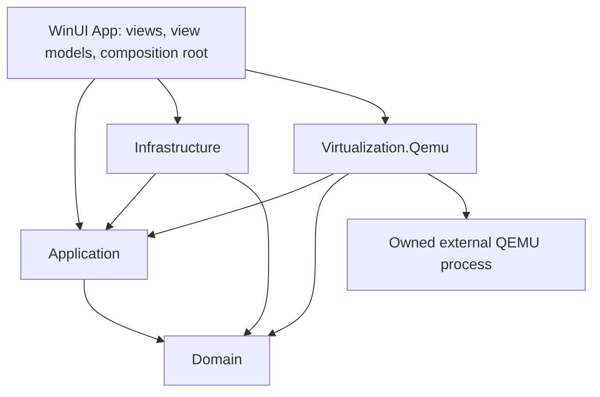

# UTM4WIN Architecture and Development Plan

Status: M0 accepted for the qualified Windows 11 x64/100%-scaled profile; M1–M4 completed for the qualified host/profile following their respective user instructions. M5 is in progress: the first increment replaces the interim SDL window with an integrated native guest console (section 35). Eighty ordinary tests and six explicit QEMU integration tests pass. The user confirmed physical input and monitor movement; the console observed 100% and 125% scaling. Networking and the complete installed-Linux workflow remain M5 acceptance gates. M6–M8 are not started; production release and QEMU redistribution remain unapproved.
Evidence reviewed: 2026-10-14. Continuation after UI alignment authorizes M4 lifecycle/control. Already approved QEMU tools, Debian ISO and a new copy of the earlier disposable test guest were reused. Additional dependencies/media and system changes require their own authorization; the integrated console remains the next milestone.

## 1. Product goal and scope

Build an independent Windows 11 VM manager in C# and .NET 10 using native WinUI 3, Windows App SDK and MVVM. The user's later clarification makes close UTM-for-macOS visual and interaction fidelity an explicit product goal: screen composition, visual hierarchy, VM presentation, guided creation and settings should feel recognizably similar. WinUI is the implementation technology; a generic Fluent dashboard is not the intended final design. Preserve appropriate Windows window/input/file-picker conventions and original UTM4WIN assets. Rider remains the development IDE. No upstream source or branding is copied.

The recommended first backend is an external QEMU process with WHPX for compatible guests and explicitly selected TCG emulation where appropriate. This is a provisional architecture: the selected Windows QEMU build, display integration and toolchain must pass milestone M0 before becoming implementation commitments.

The first usable release targets Windows 11 x64 hosts and an x86_64 Linux guest. It includes VM creation from a user-supplied ISO, a managed qcow2 disk, configuration editing while stopped, user-mode networking, guest display and input, pause/resume, shutdown, explicit force stop, persistence and actionable errors. Windows guests are a subsequent compatibility milestone. Do not advertise Windows 11 guest support before validating UEFI, Secure Boot, vTPM and guest drivers.

Deferred: Windows on ARM64, additional emulated architectures, snapshots, suspend-to-disk, shared folders, clipboard, audio, USB redirection, bridging, remote access, guest automation, galleries and a Hyper-V management backend. GPU passthrough, gaming-grade 3D and macOS guest installation are outside the initial roadmap. No promise of full UTM feature parity.

UTM's public positioning distinguishes virtualization from slower cross-architecture emulation and provides separate QEMU and Apple Virtualization paths. This is product context, not proof of Windows compatibility. [UTM website](https://mac.getutm.app/), [upstream repository](https://github.com/utmapp/UTM).

## 2. Repository and development environment evidence

Read-only inspection established:

| Item | Observed result | Consequence |
| --- | --- | --- |
| `UTM4WIN.sln` | Solution with configuration sections and no projects | No application build or test is currently meaningful |
| `PLAN.md` | Absent before this planning task | This document is the first proposed roadmap |
| `reference/UTM-main/` | Local Swift/Objective-C UTM source is present | Use this copy without downloading or executing it |
| PATH-resolved `dotnet --info` | x64 .NET host/runtime 8.0.21; no SDK found by this installation | This lookup does not cover Rider's private .NET installation; see M0 follow-up evidence |
| PATH lookup | `qemu-system-x86_64`, `qemu-img`, `msbuild` not found | Availability elsewhere is unknown; do not claim they are absent system-wide |
| Standard Windows SDK include path | No entries returned | Windows SDK installation and location remain unverified |
| Host OS via CIM | Windows 11 Pro, build 26200, 64-bit | Only this development host was inspected |
| CPU via CIM | AMD; firmware virtualization reports true; SLAT reports false | These flags alone cannot establish WHPX readiness; reconcile with WHP capability checks and a boot experiment |

The initial planning inspection did not verify Windows Hypervisor Platform feature state, effective hypervisor availability, Windows App Runtime installation, Rider version or Build Tools components. The M0 follow-up below supplies that evidence. No QEMU binary was run, no VM booted and no dependency installed. Existing staged and unstaged user changes present during planning were left untouched.

## 3. Local UTM implementation findings

All paths below are relative to `reference/UTM-main/`. Findings refer to inspected implementation sections of this local copy, not an assumed upstream release. A source commit identifier is not established for the downloaded directory.

| Inspected path and symbol | Actual implementation finding | Classification and Windows implication |
| --- | --- | --- |
| `Services/UTMVirtualMachine.swift`: `UTMVirtualMachine`, `UTMVirtualMachineCapabilities`, `UTMVirtualMachineState`, `UTMVirtualMachineStopMethod` | Common async lifecycle contract, explicit capability flags, transitional states, and separate request/force/kill stop modes | UTM application logic; adopt the principles in independent C# contracts |
| `Services/UTMQemuVirtualMachine.swift`: `_start(options:)`, `start(options:)` | Configures resources, optional software TPM and SPICE/interface, starts QEMU, restores resources, then continues boot; failed start kills the owned VM and resets state | UTM orchestration over QEMU; design startup as an owned, reversible resource acquisition sequence |
| Same file: `stop(usingMethod:)`, `determineSnapshotSupport()` | Requested shutdown calls the monitor; snapshot support rejects specific accelerator/device combinations, including disposable mode, GL displays and NVMe | QEMU behavior filtered by UTM policy; neither shutdown success nor snapshot support can be inferred from command acceptance |
| `Services/UTMQemuSystem.m`: `startQemu`, `didLoadDylib:`, `startQemuWithCompletion:` | Resolves `qemu_init`, `qemu_main_loop`, `qemu_cleanup` dynamically and launches the architecture-specific softmmu component through UTM's process abstraction | Apple-specific QEMU integration; this is not evidence that stock Windows QEMU is a drop-in library |
| `Configuration/UTMQemuConfiguration.swift`: `CodingKeys`, `init(from:)` | Typed system, drive, display, network and sharing sections; rejects wrong backend and unsupported configuration versions | UTM configuration logic; use versioned JSON and explicit migrations on Windows |
| `Configuration/UTMQemuConfiguration+Arguments.swift`: `spiceArguments` | Constructs SPICE arguments and a monitor chardev; local QMP is carried through a SPICE port, remote mode uses a pipe | QEMU plus UTM transport choice; keep Windows control and display independent |
| `Services/UTMSpiceIO.m`: `initializeSpiceIfNeeded`, `startWithError:` | Uses CocoaSpice connections, display/input channels, optional audio and clipboard, Unix sockets or remote TLS | SPICE functionality with Apple client integration; CocoaSpice is not a WinUI client |
| `Services/UTMQemuSnapshotBackend.swift`: `snapshotImageURLs`, `UTMQemuLiveSnapshotBackend`, `UTMQemuFrozenSnapshotBackend` | Live operations use the monitor; stopped-image operations use qemu-img; tracks all participating disks and UEFI variables and detects incomplete inventories | UTM snapshot orchestration over QEMU; multi-resource consistency needs a separate design and recovery policy |
| `Services/UTMAppleVirtualMachine.swift`: `_requestStop`, `_forceStop`, `validateGuestProvisioning` | Calls `VZVirtualMachine` APIs on a VM queue; macOS guest provisioning is OS- and architecture-gated | Apple Virtualization Framework; no direct Windows equivalent or planned port |
| `Platform/Shared/VMWizardState.swift`: `VMWizardPage`, `VMWizardState` | Explicit wizard pages, history and OS/boot/hardware options, separate virtualization and Apple-backend choices | UTM workflow plus Apple-specific branches; build Windows guest profiles and capability-aware steps |
| `Platform/UTMData.swift`: `create`, `clone`, `export` | Creates and saves before library insertion; cloning changes UUID and optionally MAC; export removes an existing destination before copying | UTM library workflows; implement independent identity handling and explicit overwrite checks, not upstream replacement behavior |
| `Services/UTMRegistry.swift`: `entry(for:)`, registry initialization | UUID-keyed host registry with observation and debounced serialization | UTM host-specific persistence; separate portable VM configuration from local library/UI metadata |
| `LICENSE` | Apache License 2.0 text | Covers the inspected upstream license file; it does not establish licensing for every dependency or asset |

Architecture lessons: capability-driven UI, explicit state transitions, separation of portable and host-specific data, safe startup cleanup, and separate live/offline image operations. SwiftUI, AppKit, security-scoped bookmarks, Metal, CocoaSpice and VZ APIs require independent Windows designs. The inspected application imports QEMUKit components; their internal QMP implementation was not established by these reads and is not asserted here.

## 4. Backend decision and feature feasibility

| Candidate | Advantages | Constraints | Recommendation |
| --- | --- | --- | --- |
| QEMU + WHPX | Hardware acceleration with QEMU devices and control protocol | Depends on host capability, guest architecture, build options and device compatibility | Primary candidate; validate in M0 |
| QEMU + TCG | Software emulation, including different guest architectures | Substantially different performance; guest/device profiles still need tests | Explicit alternative; no silent fallback |
| Hyper-V VM management | Windows-managed VMs and platform integration | Role/edition requirements, different storage/control/display model; no general cross-ISA emulation | Deferred backend if user demand justifies it |
| Direct WHP API VMM | Fine-grained control | Requires a VMM, devices, firmware, disk/network/display implementation | Rejected for initial scope |
| Apple Virtualization Framework | Relevant to the reference app | Apple platform API | Not a Windows backend |

WHPX is QEMU's accelerator using Windows Hypervisor Platform; it is distinct from managing Hyper-V VMs. QEMU's current master documentation describes x86_64 and ARM64 hosts; ARM64 has specific Windows update requirements. Installed release binaries may lag master. [QEMU WHPX documentation](https://www.qemu.org/docs/master/system/whpx.html).

The Hyper-V role is unavailable on Windows Home; this must not be used as a blanket conclusion about WHP availability. Edition-specific WHP support is a test item, including Windows 11 Home if offered as a supported host. [Microsoft Hyper-V installation requirements](https://learn.microsoft.com/en-us/windows-server/virtualization/hyper-v/get-started/install-hyper-v?pivots=windows).

Proposed compatibility policy:

| Host / guest | Execution policy | Release status |
| --- | --- | --- |
| x64 / x86_64 Linux | WHPX preferred after runtime proof; user-selected TCG alternative | Initial qualification target |
| x64 / x86_64 Windows | Same accelerator policy; qualified firmware/TPM/driver profile required | M6 |
| x64 / ARM64 or other ISA | TCG with an architecture-specific QEMU binary and guest profile | Deferred |
| ARM64 / ARM64 | Investigate WHPX with supported OS updates and matching QEMU build | Future host milestone |
| ARM64 / x86_64 | TCG candidate, not x86 WHPX acceleration | Deferred |

Capability detection combines OS/build/architecture, WHP runtime availability, selected executable identity/version, compiled accelerators/devices/display backends, and an actual disposable boot test. A help listing proves compilation support, not operational acceleration. Avoid reducing security mitigations to gain speed. Report the chosen execution mode before start.

## 5. Modular architecture and proposed solution structure

Create these directories/projects only in their approved milestones:

```text
src/
  UTM4WIN.Domain/                 net10.0
  UTM4WIN.Application/            net10.0
  UTM4WIN.Infrastructure/         net10.0-windows...
  UTM4WIN.Virtualization.Qemu/    net10.0-windows...
  UTM4WIN.App/                    net10.0-windows...; WinUI 3 x64
tests/
  UTM4WIN.UnitTests/
  UTM4WIN.IntegrationTests/       Windows; explicitly opt-in QEMU tests
```

Use a pinned Windows TFM/SDK and minimum supported OS determined in M0. Explicitly declare PerMonitorV2 in the native application manifest and verify the resulting window's awareness; section 26 shows why this cannot be inferred from WinUI alone. The current Microsoft quickstart includes .NET 10 WinUI targets, but compatibility must be established with a stable Windows App SDK package and the actual toolchain. [Microsoft WinUI quickstart](https://learn.microsoft.com/en-us/windows/apps/get-started/start-here?tabs=stable), [Windows App SDK release channels](https://learn.microsoft.com/en-us/windows/apps/windows-app-sdk/release-channels).



The App references concrete adapters only to register dependencies. View models consume application use cases. Domain references no UI, process, logging package or QEMU implementation. Application defines ports; Infrastructure and Virtualization.Qemu implement them and do not depend on each other. Use standard .NET facilities within each adapter rather than introducing a shared catch-all project.

Responsibilities:

- Domain: VM identity, strongly typed configuration, architecture and execution mode, disk ownership, capabilities, validation and lifecycle rules.
- Application: create/edit/start/pause/resume/shutdown/remove use cases, per-VM operation serialization and session coordination.
- Infrastructure: JSON repository, library index, atomic writes, paths, host diagnostics, log storage and approved OS integration.
- Virtualization.Qemu: executable qualification, guest profiles, deterministic argument generation, process/job lifetime, QMP and qemu-img operations.
- Presentation: Fluent navigation, forms, session views, progress and errors; thread dispatch and rendering adapters remain UI concerns.

Initial ports: `IVmRepository`, `IHostCapabilitiesService`, `IVirtualizationBackend`, `IVmSession`, `IDiskImageService`. Add display contracts at M0/M5 only to the granularity the chosen integration requires. `IVmSession` owns async lifecycle commands, observed state and disposal. Capabilities carry availability and explanatory reasons per feature/configuration; do not use a single global boolean for snapshot support.

Use CommunityToolkit.Mvvm observable state and asynchronous commands in view models, standard Microsoft DI and structured `ILogger` logging. Toolkit cancellation aids UI coordination but does not itself undo backend side effects. [MVVM Toolkit](https://learn.microsoft.com/en-us/dotnet/communitytoolkit/mvvm/), [async command generation](https://learn.microsoft.com/en-us/dotnet/communitytoolkit/mvvm/generators/relaycommand).

Do not introduce plugins, a background Windows service, an event bus, database or a separate contracts assembly until a concrete approved requirement needs them. UI code-behind is limited to view/rendering/window integration.

## 6. VM configuration and persistence

Proposed VM directory: `<chosen library root>/<vm-id>/vm.json`, `disks/`, and per-VM writable firmware variables where required. Host library index, preferences and bounded logs live under the user's local application data. Names are presentation metadata; renaming does not rename the storage directory.

`vm.json` contains schema version, UUID, backend/profile identifier, guest ISA, machine version, execution mode, vCPU count, memory in MiB, firmware references, typed storage/network/display settings and resource ownership. Store portable owned-resource paths relatively; explicitly referenced external images/ISOs remain external. Do not store process IDs, live state, QMP channels, passwords or UI geometry as portable configuration.

Validation checks host/profile compatibility, sensible CPU/memory/disk bounds, image format and access, duplicate resource IDs/MACs, reserved Windows names, missing ISO/firmware and conflicting host ports. For paths inside the VM root, reject traversal, aliases and reparse-point escapes; preserve externally referenced files and follow explicit ownership rules. Detect backing chains and reject unsupported external dependencies rather than importing them silently.

Write configuration to a temporary sibling, flush and replace under a per-VM lock; keep a recoverable previous version. Do not assume replacing configuration and updating the library index is one atomic operation. Reconcile UUID-keyed entries at startup, recognize incomplete creation, and retain artifacts needing recovery. Unknown newer schemas open read-only or fail clearly; migrations preserve originals and never silently downgrade.

Editing creates a draft and checks for conflicting changes at save. MVP hardware editing is stopped-only. Register a new VM only after its files and configuration are committed. Cancellation cleans up only artifacts created by that operation with proven ownership. Removal from the library and deletion of owned data are separate user actions; disk deletion requires explicit authorization and stopped/unowned-session verification.

## 7. QEMU process lifecycle and QMP

One external QEMU process per running VM. Use a validated absolute executable path, a controlled working directory, `UseShellExecute=false`, and `ProcessStartInfo.ArgumentList`. Never pass user-defined shell strings. Shell-safe argument separation does not replace escaping QEMU's own option syntax: file names containing commas need explicit handling. Guest profiles select supported devices and image formats, not arbitrary extra arguments. [QEMU invocation syntax](https://www.qemu.org/docs/master/system/invocation.html).

Qualified ownership mechanism (section 22): create each child through `CreateProcessW` with `STARTUPINFOEX`, an unnamed kill-on-close Job Object supplied through `PROC_THREAD_ATTRIBUTE_JOB_LIST`, and an explicit standard-handle allowlist. Job membership is established during creation; `CREATE_SUSPENDED` supplies a verification barrier before resuming the initial thread. Reject creation/verification/resume failures without an uncontained fallback. Keep the job handle non-inheritable and retain it for the session. Suspended creation followed by a separate assignment is insufficient if the parent dies between those calls. This native Windows boundary is justified because `Process.Start`/`ArgumentList` does not expose atomic job assignment; its Windows argument encoding requires independent round-trip qualification. Job close is abrupt termination, so normal app exit first offers guest shutdown/cancel and explicit force-stop confirmation. No detached background VM mode in MVP. [Microsoft process attributes](https://learn.microsoft.com/en-us/windows/win32/api/processthreadsapi/nf-processthreadsapi-updateprocthreadattribute), [Microsoft Job Objects](https://learn.microsoft.com/en-us/windows/win32/procthread/job-objects).

Preferred control transport to prove in M0 is dedicated redirected stdio for QMP, with guest serial routed elsewhere and diagnostics on stderr. Do not multiplex HMP, guest console and QMP. This avoids exposing a monitor network listener. If the selected binary cannot support reliable isolated stdio, evaluate a user-restricted local transport; named-pipe behavior and ACLs must be verified rather than assumed. Unauthenticated TCP is not an accepted production control fallback.

QMP protocol handling: greeting, `qmp_capabilities`, unique request IDs, one bounded asynchronous reader, serialized writes, correlated responses/errors and separately delivered events. Support fragmented/coalesced messages, bounded payloads, timeouts and disconnects. Canceling a request does not prove QEMU canceled the command; reconcile state before reporting an outcome. [QMP specification](https://www.qemu.org/docs/master/interop/qmp-spec.html).

Supported initial commands are `query-status`, `stop`, `cont`, `system_powerdown` and `quit`, discovered against the selected binary's supported commands. `system_powerdown` requests guest cooperation; its successful response does not prove shutdown. `quit` ends QEMU without promising a clean guest filesystem. Wait for process exit before declaring the VM stopped and freeing resources. [QMP command reference](https://www.qemu.org/docs/master/interop/qemu-qmp-ref.html).

Managed shutdown policy qualified in section 21: start the tested guest with `-no-shutdown`; on genuine guest SHUTDOWN/STOP, retain process/disk ownership, close the authenticated display, reconcile zero VNC clients, then quit QEMU and await exit. A powered-off guest inside a live QEMU process is still Stopping, not Stopped. The probe's separate `-no-reboot` switch is not a general restart policy for production guests.

Proposed state transitions:

| Trigger | Transition | Completion evidence / failure handling |
| --- | --- | --- |
| Start | Stopped → Starting → Running | Owned process plus negotiated QMP and observed running status; unwind resources on failure |
| Pause | Running → Pausing → Paused | Backend status/event reconciliation |
| Resume | Paused → Resuming → Running | Backend status/event reconciliation |
| Requested shutdown | Running → Stopping → Stopped | Guest shutdown followed by process exit; timeout offers continue waiting or explicit force stop |
| Guest shutdown / process exit | Active state → Stopping → Stopped, or Faulted | With `-no-shutdown`, release display and terminate the owned QEMU process before Stopped; classify unexpected exit separately |
| QMP lost while process lives | Active state → Disconnected | Preserve ownership and disk exclusion; reconnect if transport permits, otherwise offer owned force stop |
| Start canceled | Starting → Stopped or Faulted | Cleanup must finish and process exit be verified |

Serialize conflicting commands per VM; events and exit notifications use the same state reducer. A failed/disconnected label never grants permission to modify disks while a process may still own them. Keep last failure separate from configuration. Do not replay destructive commands automatically. On startup, persisted session metadata is diagnostic only: a PID without executable/start-time/ownership verification must never be killed.

## 8. Storage, networking and guest integration

### Storage and firmware

Use qcow2 for newly created managed disks; raw images are an explicit compatibility option. Invoke the qualified qemu-img via structured arguments for offline creation/information/conversion only when the operation is supported and approved. Never mutate or repair an image in use; qemu-img warns that this can destroy it. [qemu-img documentation](https://www.qemu.org/docs/master/tools/qemu-img.html).

MVP creates disks at new destinations without overwrite and boots a read-only ISO. Keep per-VM UEFI variable stores separate from read-only firmware code. Firmware origin, version, architecture and license are part of the validated profile. Growing, converting and repairing existing disks are later workflows; shrinking is excluded initially. Cancellation of long storage operations preserves the source and identifies incomplete destinations.

Snapshots are M7 research, not an MVP guarantee. Distinguish offline disk snapshots, live crash-consistent disk snapshots, guest-quiesced snapshots and complete RAM/device saved state. A restore may require coordinated disks, firmware variables and TPM state. WHPX migration/save-state/device compatibility must be tested on the exact build. Multi-disk qemu-img operations are not a transaction. Require locks, preflight, backup/recovery strategy, an operation journal and explicit destructive restore approval. Do not call a snapshot a backup.

### Networking

MVP uses QEMU user-mode NAT when built with the necessary backend; optional port forwarding binds loopback by default. This avoids requiring a host bridge or privileged TAP configuration. Validate DNS, outbound connectivity, collision reporting and guest-access limitations on the chosen build. Host network changes are separate approved operations. QEMU documents user networking and explicit forwarding bindings. [QEMU networking options](https://github.com/qemu/qemu/blob/master/docs/system/invocation.rst).

Bridging, TAP drivers and Hyper-V switch integration remain deferred, with independent privilege, installation and firewall decisions. Networking enabled in a guest is not a security sandbox guarantee.

### Guest display and input: critical M0 decision

WinUI 3 hosts the application UI, but does not provide a QEMU display client. Keep display failure independent from VM process/control state. Compare these options using a real selected Windows build:

| Option | Usefulness | Main cost / gate |
| --- | --- | --- |
| External QEMU native display | Fast route to prove guest boot/input | Separate window; temporary M0/M4 tool, does not satisfy final integrated-display acceptance |
| Embedded VNC/RFB client | Potential minimal framebuffer/input integration | Must qualify a maintained compatible client, encodings, authentication, DPI, keyboard layouts and rendering cost |
| Native SPICE client via Windows interop | Potential richer guest integration | Windows server/client build availability, native ABI, packaging and licenses; no CocoaSpice reuse |
| RDP into installed guest | Useful later for enhanced sessions | Requires guest support/setup; cannot replace firmware/installer display |

Provisional M0 display candidate: the approved `Community.MarcusW.VncClient 2.0.8` package as a message/encoding core, with an independent pinned mutual-TLS adapter and the bounded Raw/ZLib profile qualified in section 23. Its default authentication/decoding paths are not accepted. ZRLE, Tight/JPEG, clipboard and extra incoming extensions remain excluded. Physical input, mixed-DPI checks and final architecture acceptance precede implementation approval; Rider qualification passed in section 26, while production adoption and redistribution remain unapproved. Do not write a general-purpose RFB/SPICE stack from scratch merely to avoid dependency review. Do not embed an external QEMU window by reparenting its HWND as the default design.

VNC is not automatically secure because it binds localhost; other local principals may reach it. Verify the selected client/server's compatible authentication and protected transport; do not rely on legacy VNC password authentication as strong security. No LAN listener or WebView/noVNC stack in MVP. [QEMU VNC security documentation](https://github.com/qemu/qemu/blob/master/docs/system/vnc-security.rst).

Input acceptance includes key down/up tracking, release on focus loss, absolute/relative pointer modes where supported, cursor capture/release, keyboard layouts, special-key actions and DPI-aware coordinate mapping. Use bounded frame queues, drop obsolete frames, decode away from the UI thread and measure allocations before considering native GPU rendering.

Clipboard and shared directories are opt-in future capabilities requiring guest-side support and a separate trust boundary. Audio and USB depend on actual client/build/device capabilities. Windows 11 guests require a qualified software TPM implementation and firmware configuration; do not assume swtpm availability from its use in macOS UTM or bypass guest security requirements.

## 9. UI and user workflows

UTM-oriented WinUI library: a sidebar of VM entries and a selected-VM detail area, with recognizable entry icons/previews, a prominent preview region and grouped VM information/actions. Match UTM's overall composition, proportions, spacing, information density and navigation behavior closely instead of defaulting to a generic application sidebar plus a command-button row. Show useful empty/error/loading states, execution mode and unavailable-feature reasons. Use native WinUI controls and original icons, light/dark/system themes, keyboard navigation, screen-reader labels and high-contrast support. Native Windows title bars and file pickers remain appropriate platform adaptations.

Creation flow: guest profile → supported execution mode → ISO → CPU/memory → managed disk destination/size → network → review. Show required capabilities before creating files. Validate each step and the final draft; allow backward navigation and cancel without discarding existing data.

Session window: display surface, pause/resume, guest shutdown, explicit force stop and input-release action. Separate connecting display from starting guest and from booting guest OS. Show a VM can still be running while display is disconnected. Do not label a QEMU process as a fully booted guest without guest-level evidence.

Settings group hardware, storage, network and integration features. Disable unsafe edits during active sessions. Error dialogs include a short cause, a suggested action and a correlation ID with an optional redacted diagnostic view. Do not expose raw implementation details in normal creation steps.

Visual fidelity is a separate acceptance gate from functional correctness: inspect the local macOS/shared UTM views and compare actual reference screens with UTM4WIN at equivalent window sizes and themes. Library/detail composition, creation-page structure and grouped settings must be reviewed before calling the UI design complete. Existing M1–M3 functional acceptance remains valid, but their current views are scaffolding and do not satisfy this newly clarified visual goal. Unsupported controls must not pretend an unavailable operation works; platform-specific differences need a documented reason.

Use UI-thread dispatch only for bound state/rendering. I/O and virtualization stay asynchronous. VM actions use the same application rules whether triggered from a button or another future entry point.

## 10. Dependencies, distribution and licensing gates

| Component | Proposed use | Approval / evidence gate |
| --- | --- | --- |
| .NET 10 / Windows SDK / Windows App SDK | Required fixed stack | Pin stable versions and verify local build/start in M0; installation separately authorized |
| CommunityToolkit.Mvvm | Observable properties and commands | Microsoft-maintained toolkit; MIT license; verify selected package assets/generators with .NET 10 |
| Microsoft DI/logging packages | Composition and diagnostics | Select compatible .NET 10 versions; review exact packages and transitive notices |
| Test framework | Unit/integration verification | Choose one maintained .NET 10-compatible framework in M1; avoid extra assertion/mocking packages without need |
| QEMU and qemu-img | External VM engine and disk tool | User-supplied trusted build initially; provenance, features, version and dependencies recorded |
| Display client | Embedded guest console | Decision and license/maintenance evidence required in M0 before installation |
| UEFI, guest drivers and software TPM | Guest compatibility | Separate provenance, redistribution and target-build checks; defer TPM until M6 |

Microsoft's Windows App SDK and the .NET Community Toolkit repositories use MIT licenses; inspect exact release notices and transitive assets when selecting packages. [Windows App SDK license](https://github.com/microsoft/WindowsAppSDK/blob/main/LICENSE), [Toolkit license](https://github.com/CommunityToolkit/dotnet/blob/main/License.md).

QEMU's documented overall license is GPL version 2, with separately licensed parts. Running an independently developed application against an external process is a different distribution decision from linking or copying source. Bundling needs a release-specific inventory, notices and applicable source-delivery obligations; this plan does not settle legal compliance. [QEMU licensing](https://www.qemu.org/docs/master/about/license.html).

Do not bundle QEMU, firmware, drivers or a TPM binary until the user approves a concrete packaging/license strategy. The initial prototype uses explicitly selected existing executables. No automatic binary download or installer execution. Review provenance and changed versions before future upgrades.

Development preference: unpackaged x64 desktop app, with the chosen Windows App Runtime deployment approach verified. Release choice between MSIX and an unpackaged installer is deferred to M8; compare identity/runtime handling, signing, child binaries, writable data locations, upgrade and uninstall behavior. Keep VM data outside installation directories and preserve it on uninstall unless explicitly deleted. Rider is not proof that XAML compilation, packaging or debugging works; validate the actual installed build tools. [Rider desktop development documentation](https://www.jetbrains.com/help/rider/Get_started_with_net_desktop_apps.html).

## 11. Verification strategy

Unit tests must run without QEMU or WHPX: validation and schema migration, lifecycle reducer and command races, argument serialization including spaces/commas/Unicode, QMP framing/IDs/events/timeouts, configuration commit failures and storage ownership. Use controllable clocks and simple test doubles. No tests that merely mirror getters or visual spacing.

Process integration tests use a controlled helper for immediate exit, noisy stderr, startup cancellation, job ownership and abrupt parent exit. QEMU tests are opt-in, Windows-specific and use only generated disposable images and authorized guest media. Never test destructive operations on a user's VM disk. Capture versions and host capabilities with each result.

Qualification matrix: WHPX and explicit TCG; AMD and Intel where hardware is available; supported Windows editions/builds; missing feature/binary; paths with spaces/non-ASCII/commas; read-only directories; low space; stale config; malformed QMP; disconnect and process crash; repeated start/stop; two independent VMs; guest ignoring shutdown; suspend/resume of the host. ARM64 is a separate future matrix.

UI verification: wizard back/cancel/save, native window lifecycle, 100/150/200% DPI and monitor changes, theme/high contrast, keyboard-only navigation, screen reader, focus-loss key release, display disconnect and actionable errors. Automated non-UI tests cannot establish these UI properties.

Performance gates are measured after a real guest works. Proposed initial targets: no blocking VM I/O on the UI thread; UI command acknowledgment under 250 ms on the qualification host; bounded logs/frame queues with no monotonic managed-memory growth during a 30-minute session; 20 start/stop cycles without leaked owned processes/handles. Record hardware, guest and measured results; adjust guest display targets after M0 evidence. Near-native guest speed is not an unmeasured release claim.

## 12. Milestones and acceptance gates

Every milestone requires explicit scope approval before work. Approving this plan does not authorize all later milestones, installations, system changes or redistribution. M0: completed with scoped acceptance and DPI deferral in section 28. M1: explicitly resumed by the user and completed; implementation/validation appear in section 29. M2–M8: not started and not authorized.

### M0 — Feasibility and prerequisite qualification

Scope: inventory the environment and, after specific approvals for missing tools/binaries/system features, perform disposable toolchain/backend/display spikes. The user's instruction to start authorizes M0 feasibility work, including isolated spike projects when prerequisites are approved. No application scaffold or M1 implementation is authorized.

Acceptance:

- Record .NET 10, Windows SDK, stable Windows App SDK, Rider and build-tool versions; build and launch a minimal native WinUI app with the chosen unpackaged deployment mode.
- Qualify a trusted Windows QEMU build and firmware; prove x86_64 Linux ISO boot with WHPX and separately explicit TCG. Record edition/build and reconcile host capability reports.
- Prove isolated QMP transport, greeting, status, pause/resume, requested shutdown and exit handling.
- Prove owned-process cleanup including assignment failures and abrupt parent exit.
- Compare display options, prove installer display and keyboard/mouse, and propose one maintained client with package/license/build evidence.
- Record supported guest profile and unresolved issues in this plan. If any gate fails, revise the proposal for user review; do not switch UI stack.

Accepted on 2026-10-14 for the tested x64/100%-scaled host profile. By explicit user agreement, actual higher/mixed-DPI console qualification moves to required M5 acceptance; see section 28. This completes M0 feasibility, not an implementation or production-release milestone.

### M1 — Solution foundation and application shell

Prerequisite: accepted M0 decisions and specific M1 approval.
Scope: create the five projects incrementally, DI/logging, native shell, empty library and one test project; pin approved versions, nullable references and x64 settings. No virtualization feature implementation.
Acceptance: build from the documented environment, start/debug from Rider, native shell light/dark and keyboard checks pass, Domain/Application stay UI-independent, baseline unit tests run. Document any CLI/MSBuild distinction observed rather than assuming commands work.

Completed on 2026-10-14. Section 29 records the package review, implementation, executed acceptance and remaining release limitations.

### M2 — VM model, repository and library

Scope: typed configuration, drafts/validation, versioned JSON, library registration and metadata; disk tools are not required for model tests.
Acceptance: create/edit/reload metadata, migrations and unknown schemas behave predictably; duplicate IDs, missing resources, write interruption and unsaved changes tested; removing a library entry preserves disk files. No real guest advertised.

Completed on 2026-10-14; section 30 records the schema policy, persistence boundaries and acceptance evidence.

### M3 — Creation workflow and managed storage

Scope: profile-based wizard, user ISO, safe new qcow2 creation, commit/rollback of owned artifacts.
Acceptance: valid configuration and disk are created and registered once; cancel, disk-full, inaccessible paths and destination collisions preserve existing data; external ISO is read-only and never copied/deleted implicitly.

Completed on 2026-10-14; section 31 records executed verification and remaining boundaries.

### M4 — QEMU lifecycle and control

Scope: approved launch profile, owned process/job, QMP, operation serialization, state projection, logs and shutdown UX. External display may be used only as the acknowledged interim console.
Acceptance: disposable guest boots and responds to pause/resume; ignoring shutdown leaves explicit choices; crashes/disconnects/canceled startup preserve correct ownership; 20 start/stop cycles leave no processes behind; ordinary tests require no VM.

### M5 — Integrated console and usable Linux MVP

Scope: chosen display adapter, rendering/input/focus/DPI, session window, qualified NAT and complete Linux workflow.
Acceptance: create → install → reboot → pause/resume → shutdown → app restart → start persisted VM works on a disposable guest; installer and firmware console visible; keyboard/mouse and focus release verified; disconnected display does not report stopped VM; accessibility and performance checks recorded. Actual higher-DPI rendering/input and transitions between differently scaled monitors must be tested under PerMonitorV2, including image corners, letterboxes and held-input release. This mandatory DPI qualification was deferred from M0 by user agreement on 2026-10-14; arithmetic scale tests do not replace it. This is the first milestone eligible for a usable-MVP claim.

### M6 — Windows guest compatibility and selected integrations

Scope: Windows guest profile, approved firmware/TPM/driver strategy; add clipboard/folder/audio only if individually approved and validated.
Acceptance: legitimate user-supplied Windows installation completes with required guest security capabilities, persists/reboots correctly and handles helper cleanup; every integration has capability checks, opt-in controls and guest prerequisites. Unsupported guest configurations are rejected clearly.

### M7 — Advanced VM data operations

Scope: approve one operation group at a time: clone/export/import, then snapshots/saved-state only where qualified. UTM package import is separate future work, not implied by importing disk images.
Acceptance: clones receive new identity/MAC where appropriate; exports preserve destination data without explicit overwrite consent; imports validate backing chains and paths; snapshot restore tests demonstrate disk/firmware/TPM consistency and recovery from partial failure. No state-save feature released on a backend/device combination without proof.

### M8 — Release hardening and distribution

Scope: chosen packaging, license inventory, signing/runtime deployment, installation/update/uninstall and support diagnostics.
Acceptance: clean-machine install and launch on the declared support matrix; missing-QEMU recovery; approved redistribution obligations satisfied; upgrades preserve configuration and VM data; uninstall preserves guest disks; release notes list proven capabilities and limitations. ARM64 and Hyper-V management require subsequent standalone plans.

The dependency chain is M0 → M1 → M2 → M3 → M4 → M5, then separately approved M6/M7 and M8. No calendar estimate is committed before M0 resolves the native display and Windows build dependencies.

## 13. Open decisions and risk register

| Risk / decision | Impact | Resolution gate |
| --- | --- | --- |
| SDK/toolchain reproducibility | Host build/start/source-debug qualification passed; other environments remain unverified | Section 26 closes Rider host gate; pin prerequisites and validate clean-machine deployment in M8 |
| Host SLAT report and unverified WHP availability | WHPX may fail despite enabled firmware virtualization | M0: WHP capability and actual accelerated boot; no security-feature workaround |
| QEMU master docs versus distributed Windows binaries | Features/syntax/build dependencies may differ | M0: pin tested release/build and inspect its capabilities |
| Embedded display/client selection | Largest native integration and dependency uncertainty | M0: working display/input plus maintenance/license review; user accepts choice |
| QMP transport and process assignment race | Control exposure or orphaned processes | M0/M4: private transport and crash/failure ownership tests |
| Windows 11 firmware/TPM helper availability | Windows guest promises may be premature | M6: approved tested full profile |
| Multi-file state and snapshots | Data loss or inconsistent restore | M7: qualified capabilities and recovery design |
| QEMU/firmware/native dependency redistribution | Distribution obligations and upgrade complexity | M8: release-specific inventory and user-approved strategy |
| Host edition and ARM64 support | Unverified support claims | Dedicated hardware/OS qualification before advertising |
| Package/runtime deployment choice | Clean-machine launch or upgrade failures | M0 development proof; M8 release decision |

Recommended next step: review and align the existing library/detail and creation UI with the clarified UTM-oriented design before proceeding with separately authorized M4 lifecycle work. Section 32 records the visual goal and its acceptance boundary; this documentation update implements no UI redesign. M3 prepares installation media references and a blank disk; it does not start or install a guest. Actual higher/mixed-DPI qualification remains a required M5 gate; the restricted client profile and redistribution boundaries remain unchanged.

## 14. Planning validation and change boundary

This task created only `PLAN.md`. The local UTM reference was read without executing or modifying it; no application projects or future directories were created. No install, Windows feature change, QEMU execution, build/test run, Git mutation or commit was performed. Existing user staging is unchanged.

Validate this document's referenced local paths/symbols and Markdown structure before handing it over. Planning completion establishes a reviewable proposal; it does not satisfy any implementation milestone's acceptance criteria.

## 15. M0 follow-up: prerequisite inventory and execution proposal

Date: 2026-10-12. M0 was authorized after the planning handover. Read-only inventory and an in-memory WHP capability probe have run; no downloads of executable packages, dependency restores, system configuration changes or VM boots have occurred.

| Check | Verified result | Assessment |
| --- | --- | --- |
| Rider product metadata | Rider 2026.2.3.1, build 262.10968.170 | Installed; actual project debugging remains untested |
| Rider private .NET host invoked with `--info` | SDK 10.0.301, MSBuild 18.6.4, runtime 10.0.9 | .NET 10 is already available outside PATH; a second SDK installation is not an immediate prerequisite |
| Private SDK path | `%LOCALAPPDATA%/Programs/Rider/lib/ReSharperHost/windows-x64/dotnet/dotnet.exe` | Use an explicit path for the isolated spike; do not modify PATH or Rider configuration |
| Visual Studio Installer inventory via vswhere | Build Tools 2019 16.11.51; incomplete and not launchable | Do not use this installation as a validated WinUI toolchain |
| Standard Windows SDK root | Only Catalogs/Redist directories; no Include tree | No complete conventional SDK confirmed; first evaluate package-provided build tools |
| Windows App Runtime package inventory | x64 and x86 runtime 2.5.1.0 present, alongside older runtimes | Runtime prerequisite exists; actual bootstrap/startup compatibility still needs proof |
| CIM feature state | VirtualMachinePlatform enabled; HypervisorPlatform and Microsoft-Hyper-V-All disabled | WHP feature activation is not authorized; investigate the positive runtime result before requesting a change |
| `Win32_ComputerSystem.HypervisorPresent` | True | A Windows hypervisor is active |
| `WHvGetCapability(WHvCapabilityCodeHypervisorPresent)` | HRESULT `0x00000000`; 4 bytes written; Win32 BOOL true | WHP reports an available hypervisor despite disabled feature metadata; not proof that QEMU can create/run a VM |
| CPU | AMD Ryzen 7 7800X3D; firmware virtualization true, CIM SLAT false | Do not reject the host based on the CIM flag alone; QEMU WHPX boot remains the acceptance gate |
| Targeted QEMU/guest-media search | No QEMU executable or ISO found in checked tool roots and Downloads | Search was bounded, not a whole-drive inventory; a user-supplied path remains usable |
| Existing extraction tool | 7-Zip 25.01 at `C:/Program Files/7-Zip/7z.exe` | Candidate for extracting a QEMU installer without executing its installation logic |

The probe used a C# P/Invoke declaration compiled in the PowerShell process and an absolute system DLL path. It only queried capability code 0; it created no partition, virtual processor or VM and changed no Windows feature. Signature and return semantics were checked against [Microsoft WHvGetCapability](https://learn.microsoft.com/en-us/virtualization/api/hypervisor-platform/funcs/whvgetcapability). CIM states 1/2 mean enabled/disabled, respectively. [Microsoft optional-feature state documentation](https://learn.microsoft.com/en-us/windows/win32/cimwin32prov/win32-optionalfeature).

### Execution batch — subsequently approved and tested in section 16

1. Create a uniquely named isolated M0 working directory under `%LOCALAPPDATA%/UTM4WIN/M0/`, outside this repository. Use Rider's existing SDK and manually create only a minimal WinUI spike, not the production solution.
2. Restore Microsoft.WindowsAppSDK 2.5.1 and Microsoft.Windows.SDK.BuildTools 10.0.26100.9169, with their necessary transitive NuGet dependencies. Both exact versions were found in the NuGet package indexes. Qualify unpackaged x64 build and launch against the installed runtime. These are dependency downloads and require approval. Stop for a concrete setup proposal if package-provided tools cannot build XAML; do not repair/install Visual Studio or enable Developer Mode automatically.
3. Avoid adding the current official C# template package as a dependency: the NuGet index currently lists only `0.0.x-alpha` versions. A stable Windows App SDK package does not imply stable template tooling. The current Microsoft CLI quickstart also labels winapp CLI as public preview. [Official WinUI quickstart](https://learn.microsoft.com/en-us/windows/apps/get-started/start-here?tabs=stable).
4. Download the x64 QEMU 11.1.0 candidate `qemu-w64-setup-20260811.exe` (approximately 197 MB) and its published SHA-512 file from Stefan Weil's distribution linked by QEMU upstream. Verify the checksum and attempt extraction using existing 7-Zip into the isolated tools directory. Published SHA-512 retrieved during inventory: `5bcf9eed634e8575a37b74f445af41a2fe4106da512d0c30c368301d4c105037fdfab40a5287367a28a957624cddebbc8c07e16c88ab6634f554cdf3d16bf543`. Do not run the installer or alter machine PATH/registry. If extraction cannot yield a functional layout, request approval for a concrete alternative. [QEMU download page](https://www.qemu.org/download/), [Windows build inventory](https://qemu.weilnetz.de/w64/).
5. With approval to execute the extracted binaries, inspect version/accelerators/devices/displays and perform bounded diskless QMP/process-ownership tests. Test WHPX startup before proposing a Windows feature change; availability metadata and real operation must be reconciled. Do not access any user VM disk.
6. A complete Linux boot/display test still requires an authorized ISO path or a separately approved guest ISO download. Display-client selection and firmware qualification follow the selected build's actual capabilities.

Microsoft lists Windows App SDK 2.5.1 as the current stable release, and the matching runtime was found locally. This selects a spike candidate, not a verified application version. [Release-channel evidence](https://learn.microsoft.com/en-us/windows/apps/windows-app-sdk/release-channels). Exact dependency versions and restore/build results will be recorded when the execution batch is approved.

At the end of the inventory-only pass M0 remained incomplete and no WinUI/QEMU execution had occurred. Section 16 supersedes that execution status. Repository modifications for this follow-up are confined to this plan.

## 16. M0 execution results: WinUI and QEMU control/ownership

Authorization: the user explicitly approved the WinUI dependency downloads and isolated build/start tests, and QEMU download, extraction and QMP execution. Tests ran on 2026-10-12; M0 remains in progress.

### Retained evidence outside the repository

Working root: `C:/Users/DOPAMINKISTE-v2/AppData/Local/UTM4WIN/M0/run-20261012-1791836793353`.

- `WinUiProbe/`: isolated C#/XAML project, restored assets and build outputs.
- `ControlProbe/`: isolated C# QMP and Windows Job Object test harness.
- `packages/`: WinUI NuGet dependencies.
- `downloads/qemu-w64-setup-20260811.exe`: downloaded installer archive; installation logic was not executed.
- `tools/qemu/`: extracted QEMU binaries, dependencies and firmware.
- `logs/winui-build.log`, `logs/control-results.json`, `logs/ownership-failure-results.json`: build and test evidence.
- `logs/whpx-qmp-schema.json`, `logs/tcg-qmp-schema.json` and per-session QMP traces: actual protocol/schema evidence.
- `WinUiProbe/bin/x64/Debug/net10.0-windows10.0.26100.0/win-x64/probe-result.json`: loaded-window result.

These are disposable feasibility artifacts, not application projects or additions to `UTM4WIN.sln`. No upstream source was copied.

### Verified toolchain and runtime

The unpackaged x64 WinUI project targets `net10.0-windows10.0.26100.0` with minimum Windows build 22000, `UseWinUI=true` and `WindowsPackageType=None`. Its authored references are Microsoft.WindowsAppSDK 2.5.1 and Microsoft.Windows.SDK.BuildTools 10.0.26100.9169. Restore and XAML compilation succeeded using Rider's private SDK 10.0.301: zero warnings and zero errors.

MSBuild evaluation confirmed automatic Windows App SDK bootstrap initialization. The application ran against the existing runtime, raised the XAML loaded event, returned a nonzero native HWND, recorded .NET 10.0.9 and the Dark theme, then closed itself with exit code 0. No Visual Studio installation/repair, machine PATH edit, Developer Mode enablement or Windows App Runtime installer was needed.

This proves compilation, bootstrap and native window/control loading on this host. It does not prove interactive accessibility, light-theme behavior, visual correctness, DPI changes or debugging from Rider; those remain manual qualification items.

The Windows App SDK metapackage restored its component packages, including WinUI 2.3.9 and Runtime 2.5.1. Package-provided Windows SDK reference/build assets were sufficient for this spike despite the incomplete conventional SDK installation. The metapackage also brings AI/ML, Widgets, Search and WebView2 dependencies; they were not used as app features. Review whether to keep the metapackage or a documented narrower package set in M1 rather than assuming every restored component is needed.

Unexpected SDK first-run side effect: the initial SDK build reported creating an ASP.NET HTTPS development certificate. No explicit trust command ran. Later invocations set `DOTNET_GENERATE_ASPNET_CERTIFICATE=false` and disabled CLI telemetry for those processes. No certificate cleanup was performed because ownership and effects should not be assumed. Avoid claiming that the first SDK invocation had no user-profile side effects.

### Verified QEMU binary and transport

The downloaded archive's SHA-512 matched the published value recorded in section 15. Extraction with existing 7-Zip succeeded; QEMU's installer was not run.

Actual reported binary: `11.1.0 (v11.1.0-12130-ge470268ff4)`. This identifies a build beyond the release tag, not proof of a pristine 11.1.0 source release. Executable SHA-256: `47d57a6072e0bb3bd98f87926eb129eb1736dfe818c67b3b81ef7ce4edd0b3cd`.

Binary capability listings include TCG and WHPX, display backends none/GTK/SDL/egl-headless/curses/spice-app/dbus, and SPICE server options. QMP schema advertises query-vnc, query-spice, screendump, input commands, migration and snapshot commands. Listings establish compiled/protocol availability only, not successful rendering, security interoperability, saved-state support or guest compatibility.

The test profile was diskless q35 with 128 MiB RAM, start-paused, no default devices/display/serial/HMP, QMP on dedicated redirected stdio and no reboot. No TCP monitor or display listener was exposed, and no user disk or ISO was accessed.

| Executed check | Result | Boundary |
| --- | --- | --- |
| WHPX startup and QMP greeting/capability negotiation | Passed | Hardware-accelerated QEMU process initialized without a Windows feature change |
| WHPX query-status → cont → stop → cont | Observed prelaunch, running and paused as expected | Diskless firmware execution, not an installed Linux/Windows guest |
| TCG startup and equivalent lifecycle | Passed | Same restricted profile |
| system_powerdown on both modes | QMP acknowledged the command | No guest OS was present; graceful guest shutdown was not demonstrated |
| QMP quit on both modes | Process exit code 0 and cleanup | QEMU termination is distinct from guest filesystem shutdown |
| 20 additional TCG start/negotiate/query/quit cycles | All passed | Process/control cycles, not 20 installed-guest boot cycles |
| Abrupt helper-parent exit after Job Object assignment | QEMU child exited automatically | Kill-on-job-close works on this host after assignment |
| Injected assignment failure using an already closed job | Rejection observed; owned child explicitly terminated | Synthetic failure path, not comprehensive nested-job/OS failure coverage |
| Cancellation during startup greeting read | Read canceled; closing the assigned job terminated the child | Does not establish cancellation semantics for every QMP operation |
| Final process inventory | Zero QEMU processes from this extraction remained | Other user processes were not stopped |

Total: 25 recorded successful control/ownership checks. The control harness built without warnings after a nullable annotation correction. An initial self-launch argument error in the abrupt-parent test was corrected before recording the successful run; it was a harness error, not a QEMU failure.

WHPX stderr included `warning: Ignoring request for interrupt vector 0` while the diskless profile was running. Retain and investigate this with the real guest/profile; do not present the WHPX result as warning-free or full guest certification.

The launch-to-job-assignment race is still unresolved: the harness used `Process.Start` followed by job assignment. Cleanup tests prove behavior after assignment and explicit cleanup on the injected failure, not containment before the child begins executing. M4 should use a validated suspended native launch/assignment/resume path if containment before execution is required.

### Display and firmware follow-up

Extracted firmware includes separate x86_64 EDK2 code, Secure Boot code and an i386-named variable template. Firmware JSON contains Unix-style `/usr/local/share/` paths, so the extracted metadata must not be used unchanged for Windows automatic discovery. No firmware profile or Secure Boot behavior was qualified.

Read-only dependency research identified Community.MarcusW.VncClient 2.0.8 as a possible platform-independent C# protocol core with separate UI adapters. Its community repository identifies an MIT license and recent package publishing, but its README still labels the library alpha. A WinUI rendering/input adapter, actual TLS/authentication support and QEMU interoperability need source/package inspection and practical tests. NuGet's computed .NET 10 compatibility is not runtime qualification. No VNC client package was installed. [Candidate repository](https://github.com/karbonbaron/MarcusW.VncClient), [candidate package](https://www.nuget.org/packages/Community.MarcusW.VncClient/2.0.8).

Remaining M0 gates: authorized Linux ISO and real guest boot under WHPX/TCG; meaningful guest shutdown; embedded display/input/authentication candidate approval and test; firmware/profile validation; native launch containment decision; interactive WinUI/Rider verification. Windows feature activation is not currently justified by the successful restricted WHPX test.

Repository changes in this execution batch: only this plan. All changes remain unstaged/uncommitted; no Git mutation, installer execution, reference modification or M1 implementation occurred.

## 17. Official Debian ISO and installer boot verification

Authorization: the user explicitly authorized downloading an official Debian ISO for the pending M0 boot tests. Date: 2026-10-12.

### Download and integrity

- Image: `debian-13.7.0-amd64-netinst.iso`, selected from the current official Debian amd64 ISO directory.
- Source: `https://cdimage.debian.org/debian-cd/current/amd64/iso-cd/debian-13.7.0-amd64-netinst.iso`.
- Local file: `C:/Users/DOPAMINKISTE-v2/AppData/Local/UTM4WIN/M0/run-20261012-1791836793353/downloads/debian-13.7.0-amd64-netinst.iso`.
- Size: 792,723,456 bytes (756 MiB).
- Verified SHA-512: `ef04d0276850d70e4aaec0b55003628660e9631b26e35215a70ab3c8c707294a4b12731bc73c75a932902f703a7c278310ca99df28d6b36fb06d5618d8d0f678`.
- Checksum list and detached signature retained as `downloads/debian-13.7.0-SHA512SUMS` and `downloads/debian-13.7.0-SHA512SUMS.sign`.
- SHA-512 matched the official checksum obtained over HTTPS. The detached OpenPGP signature was retained but not independently verified against a trusted Debian signing key; do not claim signature verification.
- Machine-readable download provenance: `logs/debian-download.json`.

Debian's official network-install page links to the amd64 images. Netinst can boot the installer without completing a network installation; a later full installation may require additional downloads. [Official Debian netinst page](https://www.debian.org/distrib/netinst).

### Executed boot profile and observed behavior

The isolated harness started two separate VMs with the already qualified QEMU binary: q35, 1 GiB RAM, two vCPUs, BIOS defaults, the verified ISO as CD-ROM, CD boot order, no writable virtual disk, no guest networking, no native display window, and dedicated QMP stdio. One VM used WHPX and the other explicitly used TCG. Guest framebuffer captures were obtained with QMP screendump; no VNC/SPICE client dependency or display listener was added.

| Observation | WHPX | TCG |
| --- | --- | --- |
| Debian BIOS installer boot menu | Visually confirmed | Visually confirmed |
| Enter key starts graphical installer | Confirmed | Confirmed |
| Linux graphical installer language page | Visually confirmed | Visually confirmed |
| Down key changes selected language from English to Esperanto | Visually confirmed | Visually confirmed |
| system_powerdown request | Acknowledged; installer still running after approximately 30 seconds | Acknowledged; installer still running after approximately 30 seconds |
| Explicit QMP quit | QEMU exit code 0 | QEMU exit code 0 |
| Follow-up exit regression after harness correction | Harness and QEMU exit code 0 | Harness and QEMU exit code 0 |

Evidence is retained under `logs/debian-whpx/` and `logs/debian-tcg/`, including QMP traces, stderr, result JSON and sequential screenshots. The boot menu appears in `screen-001.png` for both modes. Inspected post-input installer screenshots: `logs/debian-whpx/screen-014.png` and `logs/debian-tcg/screen-014.png`.

The WHPX interrupt-vector warning recorded in section 16 also occurred during this boot; the inspected installer screens remained functional. This is an observed limitation, not an assurance that every guest/device combination tolerates it.

The first boot harness attempted another screendump after issuing quit, racing QEMU process exit and reporting an EndOfStreamException even though both QEMU processes exited successfully. The harness now waits for process exit immediately after quit. Separate short BIOS-menu sessions under `logs/debian-whpx-exit-check/` and `logs/debian-tcg-exit-check/` verified the correction with exit code 0. Original logs remain available rather than being silently replaced.

Final process inventory found zero QEMU processes belonging to the extraction. The ISO and evidence are retained for later qualification. No virtual hard disk was created, no Debian installation or partitioning was performed, and no Windows features, firewall rules, machine PATH or reference files were modified.

### Interpretation and remaining work

This closes the ISO prerequisite and demonstrates actual Linux installer boot plus basic framebuffer and keyboard behavior on both execution modes. It does not establish an installed persistent guest, UEFI/Secure Boot compatibility, guest networking, graceful OS shutdown, pointer capture or an embedded WinUI VNC/SPICE console. A QMP screenshot is evidence of the guest framebuffer, not a completed display integration.

M0 remains incomplete until its remaining acceptance gates are met. M1 is not authorized. This task modifies only `PLAN.md` within the repository; the ISO, harness updates and test outputs are outside the repository and all Git changes remain unstaged/uncommitted.

## 18. Embedded WinUI VNC display feasibility

Authorization: the user's continuation instruction approved the pending isolated M0 display probe. Date: 2026-10-12. No production application project or additional VNC package was introduced.

### Candidate source review and revised decision

Context7 did not resolve the candidate library; primary upstream source was inspected instead. Review is pinned to community repository commit `23b030ace13efa17e6afcbde90a2c3d0dd8ad8a2`:

- `src/MarcusW.VncClient/Protocol/Implementation/SecurityTypes/VeNCryptAuthenticationSecurityType.cs`: both TLS helpers unconditionally accept peer certificates. For TLSNone/TLSVnc and X509None/X509Vnc, the returned authentication result does not carry the upgraded stream; the VNC challenge path also is not performed in those branches. These are source findings, not a runtime audit of every authentication mode.
- `src/MarcusW.VncClient/Protocol/Implementation/Services/Transports/SSLTransport.cs`: `IsEncrypted` is unconditional, even though the constructor accepts a generic stream.

The repository identifies an MIT license and its README describes alpha quality. The inspected core project references BouncyCastle.Cryptography and Microsoft logging abstractions. Recent maintenance and NuGet's computed framework compatibility do not establish authentication correctness. No package was restored or executed, and this commit has not been proven identical to NuGet 2.0.8. The unmodified candidate is not selected for production. [Pinned authentication implementation](https://github.com/karbonbaron/MarcusW.VncClient/blob/23b030ace13efa17e6afcbde90a2c3d0dd8ad8a2/src/MarcusW.VncClient/Protocol/Implementation/SecurityTypes/VeNCryptAuthenticationSecurityType.cs).

To separate native rendering feasibility from client selection, a bounded diagnostic RFB client was written only in the existing external M0 scratch root, under `DisplayProbe/`. It implements Raw rectangles, desktop-size changes and basic input, with size/count checks and cancellation. It is a disposable diagnostic, not a production protocol implementation or justification to maintain a complete custom RFB stack. No upstream source was copied into UTM4WIN.

### Tested transport and rendering

The existing WinUI packages and Rider SDK built this second native WinUI executable with zero warnings/errors. QEMU retained the verified Debian ISO, q35, 1 GiB RAM, two vCPUs, no writable disk, no guest networking and QMP stdio. The final input profile added an emulated xHCI controller and USB tablet.

VNC listened on an ephemeral IPv4 loopback port with `tls-creds-x509`, `endpoint=server`, and `verify-peer=on`. The client required VeNCrypt 0.2/X509None, a valid private-root certificate chain and hostname, and a SHA-256 server certificate pin; it offered a client certificate issued by the same temporary CA. X509None here omits the additional RFB password, not QEMU's TLS client verification. No downgrade to anonymous or plaintext authentication was allowed. QEMU documents client verification and the USB tablet's absolute coordinates. [QEMU VNC security](https://www.qemu.org/docs/master/system/vnc-security.html), [QEMU USB emulation](https://www.qemu.org/docs/master/system/devices/usb.html).

Temporary certificates were generated locally with short lifetimes. The server-key directory inherited no parent permissions and granted access to the current user. No certificate was installed or trusted in a Windows certificate store. Schannel rejected the initial ephemeral client private key, so the client certificate used a temporary user key container; its absence after certificate disposal was independently checked in both final runs. The owned server private-key PEM was deleted after each completed run. Public certificates and diagnostic evidence remain.

Raw BGRA guest pixels were copied into a native WinUI `WriteableBitmap` and displayed by an `Image`. PNG artifacts were captured from the WinUI visual tree with `RenderTargetBitmap`; they show the actual embedded control, rather than QMP screendump images placed into a mockup. [Microsoft PixelBuffer documentation](https://learn.microsoft.com/en-us/windows/windows-app-sdk/api/winrt/microsoft.ui.xaml.media.imaging.writeablebitmap.pixelbuffer).

| Final executed observation | WHPX | TCG |
| --- | --- | --- |
| Native embedded Debian boot menu and graphical language page | Visually confirmed | Visually confirmed |
| Desktop resize from 640×480 to 1280×800 | Confirmed | Confirmed |
| RFB Enter starts installer; Down selects Esperanto | Visually confirmed | Visually confirmed |
| RFB pointer click at guest position (180,454), with USB tablet, selects English again | Visually confirmed | Visually confirmed |
| Live framebuffer updates during approximately 66-second session | 126 updates | 145 updates |
| Negotiated TLS | TLS 1.3 | TLS 1.3 |
| Incorrect server pin | Certificate-validation callback rejects connection | Same |
| Missing client certificate | QEMU trace explicitly rejects it | Same |
| QMP quit | Exit code 0 | Exit code 0 |
| Temporary client key removed | Independently confirmed | Independently confirmed |

These update counts are diagnostic observations, not a comparative performance benchmark; the final runs were concurrent and requested full Raw frames. Automated transport input does not qualify manual focus, shortcut routing, DPI mapping, pointer capture or accessibility.

Final evidence directories relative to the M0 root: `logs/display-whpx-1791839293/` and `logs/display-tcg-1791839293/`. Each includes five native-control captures, `result.json`, `auth-trace.log`, and `stderr.log`. Candidate source evidence is retained in `logs/vnc-candidate-source-review.json`. Earlier failed runs remain available: the initial Schannel key issue was fixed; an early missing-certificate timeout was not accepted as proof until server tracing demonstrated the rejection.

### Unresolved QEMU failure recovery and M0 boundary

The missing-certificate connection did not receive a timely rejection at the client read. QEMU's trace reports `TLS handshake failed` with `Verify failed: No certificate was found.`, proving server rejection, while the diagnostic read required bounded cancellation. The same final runs recorded repeated GLib `WaitForMultipleObjectsEx` invalid-handle warnings: 846 under WHPX and 781 under TCG. WHPX also retained the previously observed interrupt-vector warning. A server trace establishes rejection, not healthy recovery; neither the QEMU build nor this display path is production-qualified.

Final inventory found no remaining DisplayProbe or extracted QEMU process, and no server-key PEM remained in the display evidence directories. The repository change is confined to this plan; all spike source and output remain outside it, and Git changes are unstaged/uncommitted.

M0 now has evidence for native embedded installer display, basic keyboard/pointer transport, resize and mutual TLS on this host. Its maintained production-client selection and QEMU rejection/recovery gates remain open, alongside firmware, installed-guest/shutdown, containment-before-execution and manual Rider/UI qualification. Resolve or replace the affected client/build before accepting the display architecture. M1 remains unauthorized.

## 19. TLS shutdown isolation and next client qualification proposal

Date: 2026-10-12. The user authorized continuing M0 investigation using the already approved tools. This section supersedes the provisional attribution of the GLib warnings in section 18.

### Executed recovery and shutdown tests

A separate package-free console harness, `TlsRecoveryProbe/`, tested the same QEMU binary with dedicated QMP stdio and temporary mutually authenticated TLS credentials. No guest disk, additional binary, Windows feature or certificate-store installation was introduced. All builds completed with zero warnings/errors.

Twelve diskless tests covered TLS 1.2 and TLS 1.3, each with a paused VM and a running TCG VM: normal disconnect, incorrect server pin and missing client certificate. Each tested a fresh valid connection after the failure and a QMP status request. All recovery connections produced a framebuffer; QMP remained responsive, QEMU quit with code 0, and no GLib invalid-handle warnings occurred. Missing-certificate rejection remained visible in the server trace while the client read required cancellation. Evidence: `logs/tls-recovery-1791839679/` and `logs/tls-recovery-1791839737/`.

Six further running-TCG cases isolated the connection lifetime at quit:

| Case | TLS 1.3 GLib warnings | TLS 1.2 GLib warnings |
| --- | --- | --- |
| Missing-certificate failure; another authenticated client remains connected at quit | 1,855 | 196 |
| No authentication failure; authenticated client remains connected at quit | 1,004 | 180 |
| Missing-certificate failure; authenticated clients close before quit | 0 | 0 |

Evidence: `logs/tls-recovery-1791839810/` and `logs/tls-recovery-1791839869/`. Timestamped stderr first reports warnings around process shutdown in the retained-client cases. These observations demonstrate that failed authentication is not necessary to trigger the warnings; they do not identify the exact faulty upstream source line or prove every disconnect race resolved.

The native display harness now closes its VNC client, polls `query-vnc` until no clients remain with a bounded deadline, and only then sends `quit`. Complete Debian/WinUI sessions were repeated with WHPX and TCG. Both again displayed the installer, resized to 1280×800 and passed certificate-negative checks. Pointer captures were inspected and show English selected after the scripted click. WHPX recorded 128 framebuffer updates; TCG recorded 144. Both reported client count zero before quit, QEMU exit code 0, client-key cleanup and **zero GLib invalid-handle warnings**. WHPX's earlier interrupt-vector warning remains.

Final native evidence: `logs/display-whpx-1791839925/` and `logs/display-tcg-1791839925/`. Earlier evidence is retained. Final inventory found zero remaining owned QEMU/display/recovery processes and zero server-key PEM files in the display/recovery evidence directories. Within the repository only this plan was modified; all changes remain unstaged/uncommitted.

Decision: retain the tested QEMU binary for the next M0 spike; there is no demonstrated need to replace it solely because of these warnings. Managed stop must release the display connection before terminating QEMU. Guest-initiated poweroff requires separate qualification: investigate `-no-shutdown` so the controller can observe SHUTDOWN/STOP, close the display and then quit. QEMU documents this behavior, but it has not yet been tested with an installed guest. Never conflate `system_powerdown` acknowledgement with guest shutdown. [QEMU invocation](https://www.qemu.org/docs/master/system/invocation.html), [QMP reference](https://www.qemu.org/docs/master/interop/qemu-qmp-ref.html).

### Alternative client review

- `lemutec/RemoteViewing`, commit `5705fb9feae578f9e6346bcefcbbe711bfdb3454`, is active and includes a genuine WinUI project targeting .NET 10/Windows App SDK 2.5.1. Inspection of `RemoteViewing/Vnc/VncClient.cs` (`NegotiateSecurity`) and `AuthenticationMethod.cs` established only None/Password authentication; passing an arbitrary stream does not add QEMU VeNCrypt negotiation. `LICENSE.txt` specifies BSD 2-Clause plus zlib terms, whereas both core and WinUI project metadata declare MIT. Hold pending transport and license clarification. Source evidence: `logs/remoteviewing-source-review.json`. [Pinned source](https://github.com/lemutec/RemoteViewing/tree/5705fb9feae578f9e6346bcefcbbe711bfdb3454).
- The Quamotion RemoteViewing repository is archived. It is not preferred as a new maintained dependency. [Repository](https://github.com/quamotion/remoteviewing).
- LibVNCClient is a native alternative with GPL terms and native build/deployment work. It requires a separate redistribution/license decision before adopting it; no native package was downloaded. [Upstream license](https://github.com/LibVNC/libvncserver/blob/master/COPYING).
- The original MarcusW repository identifies MIT licensing but reports its last push in August 2024. The community fork is newer, yet its default authentication remains unsuitable as documented in section 18. Neither repository activity nor availability alone establishes quality.

### Proposed spike, subsequently authorized and executed in section 20

The narrowest managed experiment is **Community.MarcusW.VncClient 2.0.8 as an encoding/message core with a separate, restricted authentication adapter**. This revises the scope of the candidate trial; it does not reverse the rejection of its unmodified security implementation or approve production adoption.

The inspected `DefaultImplementation` constructor accepts a custom security-type collection builder. `ISecurityType`, `ITransport` and `AuthenticationResult.TunnelTransport` support supplying an upgraded stream, and `RfbHandshaker` subsequently reads SecurityResult through that transport. Register only our VeNCrypt X509None implementation, use the already exercised custom-root/hostname/pin checks and client certificate, and permit no default/plaintext authentication path. Start with Raw and resize handling; qualify compressed encodings separately. Disable automatic reconnect and optional JPEG/native components for the initial test.

Proposed package pins from official NuGet metadata:

| Package | Version | Reason |
| --- | --- | --- |
| Community.MarcusW.VncClient | 2.0.8 | Published .NET 10 protocol core; MIT |
| BouncyCastle.Cryptography | 2.7.0 | Current stable required core dependency; MIT, compatible declared dependency range |
| Microsoft.Extensions.Logging.Abstractions | 10.0.9 | Core dependency, .NET 10 target; MIT |
| Microsoft.Extensions.DependencyInjection.Abstractions | 10.0.9 | Logging dependency, .NET 10 target; MIT |

At proposal time these packages had not been downloaded or restored, and source review had not established a package/commit match. The user subsequently approved this exact trial; section 20 records package provenance, runtime results and their limits. [Core package](https://www.nuget.org/packages/Community.MarcusW.VncClient/2.0.8), [Bouncy Castle package](https://www.nuget.org/packages/BouncyCastle.Cryptography/2.7.0).

Approval scope: restore these pinned packages and necessary transitive assets from official NuGet into the existing external M0 scratch root; build and run one isolated native display trial. Retain existing QEMU/ISO and certificate security. Acceptance: package/source provenance and license record, live WinUI display plus input/resize, rejection of invalid pin and absent client certificate, bounded cancellation, successful reconnect and display-disconnect-before-quit cleanup. No production project, redistribution, system change or M1 implementation is included.

M0 remains incomplete. The qualified managed-stop sequence replaces the broad TLS recovery blocker, while production-client/package qualification, guest poweroff/firmware and the other remaining M0 gates stay open.

## 20. Authorized client-core package qualification

Date: 2026-10-12. The user explicitly approved the package trial proposed in section 19. All spike projects, packages and evidence are in the existing external M0 root; this repository still contains no application project.

### Provenance and adapter boundaries

Restored exactly the four new package pins listed in section 19. The resolved dependency graph introduced no additional library beyond those pins and the previously approved WinUI packages. All four packages declare MIT licenses and passed `dotnet nuget verify --all`; the community core has a NuGet repository signature, and the other three have author/repository signatures. Evidence: `logs/client-package-verification.txt` and `logs/client-core-provenance.json`.

Core package SHA-256: `96e97225240db820ac8b10c9ce27f7897211affac771cc4378e7e51c3740a5b7`. Its nuspec repository commit matches reviewed commit `23b030ace13efa17e6afcbde90a2c3d0dd8ad8a2`. This is metadata correspondence, not proof of binary/source equivalence: no SourceLink PDB was inspected and no reproducible build was verified.

`ClientCoreProbe/` uses the actual package for RFB negotiation, Raw updates, resize and outgoing input messages. Its protocol implementation registers only the independent restricted VeNCrypt adapter. The adapter validates the private CA chain, hostname and server pin, supplies the client certificate, returns the authenticated transport, and owns both the TLS stream and underlying TCP transport. Default library authentication, compressed encodings, native JPEG and automatic reconnect are disabled. Framebuffer dimensions are bounded to 2048×2048 for this diagnostic. These bounds do not establish comprehensive malicious-server hardening.

### Failures preserved and cleanup correction

Initial native runs under `logs/client-core-whpx-1791840359/` and `logs/client-core-tcg-1791840359/` displayed the installer but did not finish cancellation/cleanup. Only the owned probe processes were terminated; job ownership released QEMU. Host termination records remain. Their server-key PEMs were removed. Their temporary client CNG key-container names were held only in process memory: removal after forced termination could not be independently verified. Do not delete unidentified user keys or claim full cleanup for these aborted runs.

An early adapter failed to dispose the base TCP transport after upgrading to TLS, producing GLib warnings in `logs/client-core-recovery-1791840407/`. Correcting transport ownership eliminated those warnings in the console recovery tests. Moving library connection/close operations to workers allowed subsequent WinUI runs to return bounded results, but both runs under `logs/client-core-*-1791840620/` still failed with a close timeout. They are not accepted.

The inspected `RfbConnection.Connection.cs`, `CloseConnectionAsync`, waits for receiver/sender shutdown before disposing the transport. The adapter now closes its owned TCP transport before awaiting library close, interrupting pending TLS reads; disposal is idempotent across threads. The successful reruns support this workaround for the tested idle/live sessions, without proving the precise cause of every previous hang. No package source was patched. [Pinned connection implementation](https://github.com/karbonbaron/MarcusW.VncClient/blob/23b030ace13efa17e6afcbde90a2c3d0dd8ad8a2/src/MarcusW.VncClient/RfbConnection.Connection.cs).

### Final executed results

Both external projects built with zero warnings/errors after corrections. Final native evidence: `logs/client-core-whpx-1791840869/` and `logs/client-core-tcg-1791840869/`.

| Observation | WHPX | TCG |
| --- | --- | --- |
| Embedded Debian boot menu and installer | Visually confirmed | Visually confirmed |
| Resize to 1280×800 | Confirmed | Confirmed |
| Enter starts installer; Down selects Esperanto; tablet click restores English | Visually confirmed | Visually confirmed |
| Negotiated TLS | TLS 1.3 | TLS 1.3 |
| Incorrect server pin | Rejected by validation callback | Same |
| Missing client certificate | Explicit server-trace rejection; bounded client cancellation | Same |
| Received framebuffer callbacks / UI refreshes | 26 / 417 | 38 / 418 |
| QMP reports no VNC clients before quit | Confirmed | Confirmed |
| QEMU and probe exit | Both code 0 | Both code 0 |
| GLib invalid-handle warnings | 0 | 0 |
| Temporary client key removal | Independently verified | Independently verified |

Framebuffer callbacks count actual package updates; UI refreshes include repeated cached frames. Neither measures guest FPS. Five captures per run came from the native WinUI visual tree. The WHPX interrupt-vector warning persists; TCG stderr is empty.

Final console evidence, `logs/client-core-recovery-1791840891/results.json`, covers normal disconnect, wrong pin and absent client certificate against running diskless TCG VMs. All three accepted a fresh authenticated connection and framebuffer after the tested event; QMP remained responsive, QEMU exited with code 0, no GLib warnings occurred and temporary client keys were removed. Its `Protocol: None` field denotes the harness's default protocol-selection setting; successful connections explicitly record TLS 1.3 and are not plaintext.

Final inventory found no remaining owned client-core/QEMU processes and no client-core server-key PEMs. Public certificates and evidence remain. The earlier forcibly terminated runs' CNG cleanup uncertainty remains as documented above.

Decision: retain this exact package plus restricted adapter as the provisional managed display candidate. The narrowly scoped trial is complete; production adoption is not approved. Remaining qualification includes compressed updates/performance, malformed-protocol handling, disconnect races, real focus/keyboard/DPI behavior and package update policy. Firmware, installed guest/guest-initiated shutdown, containment before process execution and manual Rider qualification also remain open. M0 is not complete and M1 remains unauthorized. Repository modifications are confined to `PLAN.md`, unstaged and uncommitted; the reference tree is untouched.

## 21. Firmware and persistent guest qualification

Date: 2026-10-13. The user's continuation instruction authorized the next isolated M0 firmware/installed-guest spike. The existing approved QEMU bundle, Debian ISO and client packages were reused. No additional download or host package was required. `GuestProbe/` and its artifacts are outside the repository in the same M0 scratch root.

### Firmware source, ownership and executed boot

Inspected local reference implementations `Configuration/UTMQemuConfigurationQEMU.swift`, `saveData(to:for:)`, and `Configuration/UTMQemuConfiguration+Arguments.swift`, `architectureArguments`. UTM copies the variable template when absent or explicitly reset, and emits separate read-only firmware code/writable variable pflash drives. These are UTM application policies over QEMU functionality, not macOS-only virtualization APIs. UTM's reset/deletion and file-locking choices were not copied into this probe or approved for UTM4WIN.

The approved Windows QEMU bundle's `share/firmware/60-edk2-x86_64.json` identifies `edk2-x86_64-code.fd` with **`edk2-i386-vars.fd`** as the matching variable template. Its Linux installation paths are metadata, not usable Windows paths; the probe resolves existing bundle files explicitly. Code SHA-256: `33090cc07675baa5190d9f1e84bf5176b33bcbfa9bacac522961150cdb6dbb2a`. Template SHA-256: `5d2ac383371b408398accee7ec27c8c09ea5b74a0de0ceea6513388b15be5d1e`. Firmware's independent upstream revision was not established. `share/edk2-licenses.txt` includes BSD-2-Clause-Patent and historical/component terms, including OpenSSL; redistribution remains unapproved.

Each run used a new variable-store copy, read-only firmware code, q35 and the original ISO, without a writable guest disk. Evidence: `logs/guest-firmware-whpx-1791919511/` and `logs/guest-firmware-tcg-1791919511/`. Both captures show the Debian **UEFI** boot menu and subsequent graphical language page; QEMU status was running. Both shared firmware/template hashes remained unchanged, while each owned variable copy changed. TLS 1.3 display connections closed before QMP quit, both QEMU processes exited with code 0, GLib warning counts were zero and temporary client keys were removed. These are QMP framebuffer captures, not an additional WinUI UI qualification. Secure Boot, enrolled keys, TPM and a persistent UEFI-installed guest were not tested.

### Offline installation and test corrections

The official ISO's installer kernel/initrd were extracted with Windows tar; their hashes are retained in `GuestProbe/media-provenance*.json`. The original ISO was not modified. A generated appended initramfs archive supplies preseed configuration and a guest-only diagnostic service. Direct kernel boot is a separate BIOS installation profile and does not count as UEFI installation. Debian documents initrd preseeding and account/disk configuration. [Debian preseeding](https://www.debian.org/releases/trixie/amd64/apbs02.en.html), [Debian preseed contents](https://www.debian.org/releases/trixie/amd64/apbs04.en.html).

Only newly created 8-GiB sparse qcow2 images are passed to partitioning, with `/dev/vda` as the sole writable guest disk. The installer uses ISO packages without networking/mirrors. A fresh random temporary root password avoids hardcoded credentials; bootstrap initrds are restricted to the current Windows user, and the late command locks the guest root account. No ordinary user, SSH access or guest NIC is created. Failed and superseded images are retained, not overwritten or deleted.

The first install (`logs/guest-install-whpx-1791919511/`) waited for an administrative account with the locked-root/no-user configuration. Only the owned probe was terminated; job ownership cleaned up QEMU. Recorded ownership identified its generated CNG key, which was removed and checked independently; its server-key PEM was removed. `host-termination.json` records failure and cleanup.

The second install (`logs/guest-install-whpx-1791919633/`) completed and booted Debian 13.7 with an ext4 root and persistent boot counts 1–3. Its first two ACPI-labelled runs were **not accepted as proof of ACPI response**: the guest service also scheduled automatic poweroff. A no-request counterexample (`logs/guest-boot-guest-whpx-1791919946/`) powered off after the same interval but lacked its expected serial marker. Likely terminal hangup after serial-getty startup invalidated the service's existing output descriptor; this is an explanation inferred from the behavior, not an audited kernel diagnosis. Original result files remain; their Passed flags do not override this assessment.

The corrected guest installs `acpid` and `acpi-support-base` from the already approved ISO. The ISO package's actual power-button event and handler were inspected without executing its scripts on Windows. SMBIOS product metadata selects two mutually exclusive probe modes: ACPI mode has no automatic poweroff; guest mode explicitly reopens the serial device before its poweroff marker. Startup evidence checks the selected mode, active ACPI daemon and locked root account.

### Accepted final guest results and architectural consequence

Final image: `logs/guest-install-whpx-1791920076/new-debian.qcow2`. Installation completed offline in approximately 116 seconds; this single observation is not a speed benchmark. Profile: x86_64, q35, two vCPUs, 1536 MiB RAM, BIOS/GRUB, virtio disk, 8-GiB virtual capacity, no guest NIC. Subsequent boots omit the ISO, direct kernel and installer initrd. Serial evidence identifies Debian 13.7, kernel `6.12.107+deb13-amd64`, a writable ext4 root on `/dev/vda1`, active acpid and locked root. This is a minimal console system, not a desktop/guest-tools qualification.

| Final scenario | Evidence directory under logs/ | Persistent boot count | POWERDOWN → guest SHUTDOWN |
| --- | --- | --- | --- |
| ACPI request, WHPX | `guest-boot-acpi-whpx-1791920218/` | 1 | 0.987 s |
| ACPI request, TCG | `guest-boot-acpi-tcg-1791920250/` | 2 | 1.953 s |
| Guest-only poweroff, WHPX | `guest-boot-guest-whpx-1791920278/` | 3 | No host POWERDOWN event/request |
| Guest-only poweroff, TCG | `guest-boot-guest-tcg-1791920304/` | 4 | No host POWERDOWN event/request |

All four runs explicitly validate their guest mode. Guest-only runs record the poweroff marker; ACPI runs have no timer capable of powering off. Each receives `SHUTDOWN` with `guest=true`, `reason=guest-shutdown`, followed by STOP; QEMU remains alive with status shutdown. The authenticated display then disconnects, QMP confirms no VNC clients, and explicit quit ends QEMU with code 0. All use TLS 1.3, report zero GLib invalid-handle warnings and independently verify client-key removal. The WHPX interrupt-vector warning persists; accepted TCG stderr is empty. Timing comes from QMP event timestamps and is specific to this minimal guest.

`GuestProbe/assess.py` executed assertions over all four result/event/serial logs, including event ordering and counter sequence; accepted summary: `logs/guest-final-assessment.json`. After all QEMU processes exited, read-only `qemu-img check -f qcow2` reported no image errors; info reports no dirty/corrupt flag, no backing chain and an approximately 766-MiB file. Evidence: the final install directory's `qcow2-check.txt` and `qcow2-info.json`. This checks qcow2 structure, not all guest filesystem/application data. The ISO's SHA-512 was rechecked against the earlier recorded value.

Final cleanup: no owned GuestProbe/QEMU processes or guest-test server-key PEMs remain. Credential-bearing bootstrap initrds v2/v3 were removed; generation source and non-secret hash provenance remain. All test disk images and per-run firmware variables are retained. Every generated client key in this batch was removed and checked; section 20's older aborted-run uncertainty is not retroactively resolved. No Windows feature, certificate trust, firewall or system setting was changed.

Decision: the tested BIOS Debian/virtio profile and plain UEFI installer firmware pair may proceed to the remaining M0 gates. `-no-shutdown` is the qualified controller policy for both observed shutdown paths; the state reducer must retain resource ownership until QEMU exits, as specified in section 7. Guest ACPI handling is a required capability, not guaranteed by QMP command acceptance. Secure Boot/key enrollment, TPM, persistent UEFI installation, networking and graphical installed desktops remain unqualified. Process containment before execution, broader client hardening and manual Rider/focus/DPI checks remain open; M0 is not complete. Only `PLAN.md` changed inside the repository, with no staged/committed changes or reference modifications.

## 22. Atomic process ownership before execution

Date: 2026-10-13. The user's continuation instruction authorized the pending isolated M0 process-launch spike. `LaunchProbe/` was created only in the existing external M0 root. It targets .NET 10/win-x64 and uses framework libraries plus Windows P/Invoke; no new package, executable download, installer or system change was needed.

### Mechanism and scope

Current Microsoft documentation and Win32 metadata were inspected through Context7 and primary sources. `PROC_THREAD_ATTRIBUTE_JOB_LIST` supplies job handles during process creation; `PROC_THREAD_ATTRIBUTE_HANDLE_LIST` restricts inherited handles. The new diagnostic starter creates a non-inheritable, unnamed kill-on-close job, three redirected anonymous pipes, an extended attribute list, and a suspended child with an explicit absolute executable path. It verifies membership using `IsProcessInJob` before `ResumeThread`, which must report an initial suspend count of one. No post-start assignment or unsafe retry is used. [Microsoft attributes API](https://learn.microsoft.com/en-us/windows/win32/api/processthreadsapi/nf-processthreadsapi-updateprocthreadattribute), [CreateProcessW](https://learn.microsoft.com/en-us/windows/win32/api/processthreadsapi/nf-processthreadsapi-createprocessw).

Job and process handles are not inherited by the child; only its stdin/stdout/stderr ends are permitted. Parent pipe ends, the initial thread, process handle, attribute buffers and job are released on their owned paths. Closing the job before cleanup terminates an abandoned suspended/running child. This controls process lifetime; it is not a guest filesystem/network sandbox.

Native launch requires a Windows command-line encoder instead of directly using `ProcessStartInfo.ArgumentList`. It quotes each argument, handles embedded quotes/backslashes, rejects NUL and excessive length, and never invokes a shell. Ten actual child-process round trips cover empty strings, whitespace, quotes, trailing backslashes, Unicode, newlines and inert shell characters. QEMU's separate comma-containing option syntax is still a profile validation concern.

### Executed acceptance evidence

Final build: zero warnings/errors. Final run: **47/47 checks passed**, probe exit code 0. Evidence: `logs/launch-atomic-1791921045/results.json`, with individual QEMU stderr files. The QEMU executable hash still matches section 16's qualified binary.

| Group | Checks | Observed result |
| --- | --- | --- |
| x64 structure layout, pre-resume execution barrier, stdio, argument round trip, handle allowlist | 4 | Membership verified before user code; all three streams work; unrelated inheritable event excluded |
| Missing executable, invalid PE, NUL, invalid job, injected verification/resume failure, cancellation before resume | 7 | Rejection/rollback completes; applicable suspended children exit without entry markers |
| Nested jobs; closing job with ordinary child and grandchild | 2 | Supported on this host; both descendants exit |
| Abrupt helper-parent termination before verification, before resume and while running | 9 | Three runs per boundary; children exit without relying on managed disposal/finalizers |
| Abrupt parent termination with actual QEMU, before verification and after QMP greeting | 4 | WHPX and TCG children exit at both boundaries |
| Normal diskless QEMU/QMP start, status, resume, pause, quit | 20 | Ten WHPX and ten TCG sessions; membership verified before resume; QEMU exit code 0 |
| Handle trend over those twenty cycles | 1 | Count 257 before / 261 after; cycle counts 260–261, with no progressive per-launch growth demonstrated |

The first table group comprises one combined membership/stdio/barrier check plus layout, argument and allowlist checks. Abrupt-parent tests use immediate native self-termination (exit code 97) after a gate, with an outer observer retaining process handles while the parent's private job disappears. The pre-verification gate is after native creation and wrapper setup, before the membership check; it is not a measurement of every instruction boundary inside Windows.

Earlier evidence is preserved. `logs/launch-atomic-1791920924/` failed one overly specific harness expectation: invalid PE creation returned Windows error 216 rather than expected 193. The check now requires OS rejection and records the actual code; this does not change the launcher or add fallback execution. Invalid job creation returns error 6. The intermediate successful run is retained under `logs/launch-atomic-1791920956/`.

Final inventory found zero owned LaunchProbe or extracted QEMU processes. Twenty final stderr files contain ten WHPX interrupt-vector warnings and no GLib invalid-handle warnings. No guest disk, ISO, certificate, reference source or existing spike project was modified by these tests. Repository changes are confined to `PLAN.md`, unstaged/uncommitted.

Decision: the process-creation/assignment race gate is closed for this qualified Windows 11 x64 host. Adopt this mechanism behind a Windows infrastructure boundary when implementation is approved. Production integration still needs bounded asynchronous I/O/cleanup off the UI thread, resource transfer auditing, and tests under the application's actual runtime/Rider/packaging job environment. The console spike uses synchronous native pipe handles with worker-based reads and a bounded synchronous cleanup wait; it is not production UI code. Limited handle observations do not prove unlimited-session leak freedom or universal nested-job compatibility. Broader display/client and manual Rider/UI gates remain open; M0 is not complete and M1 remains unauthorized.

## 23. Bounded Raw/ZLib display qualification

Date: 2026-10-13. The user authorized the next M0 display/client spike. `DisplayQualification/` and `DisplayWinUiProbe/` were created only in the existing external scratch root, reusing approved package pins and QEMU/ISO. No new dependency was introduced. Context7 had no matching client entry; primary source at the already reviewed commit and the actual NuGet package APIs were inspected. Source evidence: `logs/display-decoder-source-review.json`.

### New source findings and reproduced failures

All paths below are relative to the pinned dependency repository's `src/MarcusW.VncClient/`, commit `23b030ace13efa17e6afcbde90a2c3d0dd8ad8a2`:

- `Protocol/Implementation/EncodingTypes/Frame/RawEncodingType.cs`, `ReadFrameEncoding`: its direct read loop does not reject a zero-byte read while pixels remain. A truncated Raw payload retained Connected without failure notification; a short inflated ZLib payload also prevented close from completing within five seconds. [Pinned Raw decoder](https://github.com/karbonbaron/MarcusW.VncClient/blob/23b030ace13efa17e6afcbde90a2c3d0dd8ad8a2/src/MarcusW.VncClient/Protocol/Implementation/EncodingTypes/Frame/RawEncodingType.cs).
- `Protocol/Implementation/EncodingTypes/Frame/ZrleEncodingType.cs`, `ReadRleTile`/`ReadPaletteRleTile`: run length is not checked against remaining tile pixels. The small runtime case accepted a two-pixel run for a one-pixel tile. `FramebufferCursor` does check rectangle bounds; do not claim those are absent. ZRLE is excluded rather than duplicating its tile decoder in the adapter. [Pinned ZRLE decoder](https://github.com/karbonbaron/MarcusW.VncClient/blob/23b030ace13efa17e6afcbde90a2c3d0dd8ad8a2/src/MarcusW.VncClient/Protocol/Implementation/EncodingTypes/Frame/ZrleEncodingType.cs).
- `Protocol/Implementation/Services/Initialization/RfbInitializer.cs`, `ReadServerInitAsync`: an overlong desktop name becomes a fallback name without consuming/rejecting its payload. The baseline accepted initialization with a declared 2048-byte name; the guarded case rejected it before acceptance. [Pinned initializer](https://github.com/karbonbaron/MarcusW.VncClient/blob/23b030ace13efa17e6afcbde90a2c3d0dd8ad8a2/src/MarcusW.VncClient/Protocol/Implementation/Services/Initialization/RfbInitializer.cs).
- `Protocol/Implementation/MessageTypes/Incoming/FramebufferUpdateMessageType.cs`, `ReadMessage`: releasing the framebuffer in finally can publish partial data when a later rectangle fails. The old diagnostic render target published the damaged update; the transactional guarded target retained the previous golden image. This combines core callback behavior and adapter policy, not a claim that every render target behaves identically.

### Restricted independent adapter

The new adapter still delegates pixel decoding to package Raw/ZLib classes and inflation to its built-in inflater. It adds EOF rejection, compressed-length and exact inflated-pixel-count checks, initialization validation and transaction-based snapshot publication. Limits: 1–2048 pixels per dimension, 1024-byte desktop name, 1024 rectangles per update and 16 MiB + 64 KiB per compressed payload. Only the tested 32-bpp/24-depth little-endian true-color format is accepted at initialization. Incoming messages are limited to framebuffer updates and Bell; authenticated TLS/pin/client-certificate requirements and disabled automatic reconnect remain.

Only complete framebuffer updates replace the latest displayed snapshot. Decoding errors discard staging and report connection failure; no bad/partial frame replaces the last good image. These are explicit profile limits, not a general-purpose RFB stack or comprehensive hostile-server audit. The profile registers Raw, ZLib and DesktopSize only; no silent ZRLE fallback or native JPEG dependency is allowed. Exact package binaries were not patched.

### Executed results

Both projects built with zero warnings/errors. `logs/display-qualification-1791924214/results.json` records **23/23 expected outcomes**: 17 guarded checks and six comparative baseline checks. A Passed baseline means a defect/compatibility observation was reproduced, not that its unguarded path is production-qualified. The guarded checks cover exact golden pixels across two updates/persistent compression, truncated Raw/compressed input, short/excess inflation, invalid rectangles/encoding/resize/count/format, overlong names, disabled clipboard, idle disconnect and a valid-first/invalid-second rectangle update. All guarded cases retained the last valid frame where applicable and closed within five seconds.

The initial run under `logs/display-qualification-1791924017/` failed a two-second close deadline for otherwise valid images. Normal close sometimes takes approximately three seconds; the subsequent five-second bounded run passed. `Utils/BackgroundThread.cs`, `Dispose`, contains a three-second join, but exact thread timing was not instrumented. The unguarded short-ZLib case still missed five seconds and exited its isolated worker natively after recording results and removing keys; it does not become acceptable through a longer timeout.

Native WinUI evidence: `logs/display-zlib-whpx-1791924254/` and `logs/display-zlib-tcg-1791924254/`. Both use the atomic launcher from section 22 and the guarded profile; five visual-tree captures per run show installer boot, 1280×800 resize, Enter/Down selecting Esperanto and the tablet click restoring English. Invalid pin and missing-client-certificate checks pass. Both disconnect before quit, exit with code 0, report zero rejected updates/GLib warnings and verify client-key removal.

| Actual native observation | WHPX | TCG |
| --- | --- | --- |
| Wire ZLib rectangles decoded | 515 | 604 |
| Compressed pixel payload bytes | 166,128 | 172,338 |
| Equivalent Raw pixel bytes for those same rectangles | 22,732,032 | 25,068,096 |
| Complete update callbacks / UI refreshes | 24 / 420 | 50 / 420 |

Payload figures exclude RFB/TLS headers; equivalent Raw counts are computed per received rectangle, not a separate Raw benchmark. Refreshes include cached frames. These observations establish actual compression use, not guest FPS or a general bandwidth/performance guarantee.

`logs/display-recovery-1791924533/results.json` records ten fresh sessions against the same two running diskless QEMU backends (five per accelerator). Four deliberately dropped client transports report failure, close and reconnect successfully; all fresh sessions receive a framebuffer, QMP remains running, and final client count is zero before quit. Normal and failure closes stay below five seconds. Both backends exit with code 0 and no GLib warnings.

Final assessment: `logs/display-final-assessment.json`. All 23 peer cases independently verified client and synthetic-server key removal; native/recovery runs verified their client keys. No owned test/QEMU processes or relevant server-key PEMs remain. The known WHPX interrupt-vector warning persists. Earlier section 20 cleanup uncertainty remains unchanged. No guest disk, reference file or Windows system setting was modified; only `PLAN.md` changed inside the repository, unstaged/uncommitted.

Decision: retain the guarded Raw/ZLib profile as the M0 candidate; reject unmodified defaults and ZRLE. Manual Rider/focus/DPI checks and consolidated acceptance remain before M1. Long-session memory/performance testing, package upgrade policy and broader protocol coverage remain required during implementation qualification; this finite spike does not establish production release readiness.

## 24. Native focus release and coordinate mapping spike

Date: 2026-10-13. The user's continuation instruction authorized the remaining isolated M0 input/toolchain work. `InputProbe/` was created outside the repository in the existing M0 root, using only the previously approved Windows App SDK/SDK BuildTools pins. It connects to no VM, starts no QEMU and creates no certificates or disks. No reference source or system setting was changed.

Context7 provided current Microsoft WinUI focus and coordinate documentation, and JetBrains project/run documentation. XAML dimensions and pointer positions are effective pixels; physical coordinates must be converted once before using the same coordinate system. The centered Uniform mapping uses the rendered image bounds, rejects letterbox positions and excludes the right/bottom edge. Applying RasterizationScale again to already-local XAML pointer positions would be incorrect. [Microsoft coordinate source](https://github.com/microsoft/microsoft-ui-xaml/blob/main/docs/api-specs/XamlRoot-ContentIsland.md), [JetBrains project run/debug](https://www.jetbrains.com/help/rider/Run_Debug_Configuration_dotNet_Project.html).

### Executed evidence

Build with Rider's private .NET 10 SDK: zero warnings/errors. Final executable exit: 0. Evidence: `logs/input-focus-1791925945/results.json`, **32/32 checks passed**. The earlier 29-check run remains under `logs/input-focus-1791925887/`.

| Checks | Count | What was observed |
| --- | --- | --- |
| Surface focus and FocusManager identity | 2 | A focusable native UserControl receives focus |
| Owned destination and posted native KeyDown/KeyUp | 3 | Win32 messages addressed only to the probe-owned focused HWND reach the actual WinUI routed handlers |
| Held-key deduplication | 1 | Duplicate state insertion does not add another held key |
| Real native focus loss / window deactivation | 2 | Moving focus to a host button and activating a second owned window releases seeded held keys and mouse buttons |
| Coordinate matrix | 20 | Center, horizontal/vertical letterboxes, last pixel and excluded right edge at simulated 100/125/150/200% physical-to-DIP conversions |
| Invalid coordinates/layout/profile | 3 | NaN, zero layout and an oversized guest are rejected |
| Idempotent release | 1 | Repeated release adds no duplicate key/button-up messages |

The diagnostic journal records ordered key releases and button mask zero at the last guest pointer coordinates. This is an in-memory sink, not an RFB transmission result. Held modifier/button state in the focus tests is seeded directly; the posted A messages separately exercise native event routing. Posting messages does not reproduce physical keyboard state, modifiers, layouts or IME. No global keyboard/mouse injection or messages to other applications were used.

The actual window reports RasterizationScale 1 and surface dimensions 944×611 effective pixels. Other scale factors are arithmetic test inputs only; no actual monitor transition or Windows scaling change was performed. The colored surface is diagnostic, not a rendered guest framebuffer. Physical mouse/capture behavior and key-repeat policy remain unqualified.

### Toolchain boundary and remaining acceptance

Installed Rider metadata confirms version 2026.2.3.1, build 262.10968.170. The command-line build uses its private SDK; it does not establish Rider GUI build, project detection, breakpoint/source/local-value inspection or debugger exit behavior. The existing user IDE session and repository configuration were preserved. `InputProbe/MANUAL-CHECKS.md` and `Run-ManualProbe.ps1 -Interactive` provide a concrete external test project and procedure; the interactive/manual cases have not been executed.

Before completing M0, add an ordered held-input sink to the external guarded display spike and verify physical native key/pointer delivery, focus-loss releases and actual DPI transitions against the guest. The current timed VNC helper sends immediate press/release pairs and cannot qualify held modifiers. Release must preserve last pointer coordinates, remain ordered with input and handle disconnect/reconnect without carrying stale held state. Right/left modifiers, AltGr, dead keys, IME, repeat, Unicode and accessibility need their own qualification; the limited diagnostic key mapping is not a production keyboard implementation.

Consolidated status: toolchain CLI/native launch, backend/guest boot, QMP/lifecycle, atomic ownership and guarded display/recovery have executed evidence in sections 16–23. Section 24 partially qualifies native input policy; physical guest input, real DPI and Rider GUI/debugger remain acceptance gaps. M0 remains in progress. No M1 project, dependency change, redistribution decision or implementation approval is implied.

Repository changes in this task: only `PLAN.md`, unstaged/uncommitted. All probe source and results remain outside the repository.

## 25. Ordered held input over the authenticated guest display

Date: 2026-10-13. The user's continuation instruction authorized the next isolated M0 input integration. `HeldInputProbe/` and `HeldInputChecks/` were created only in the existing external scratch root. They reuse the approved .NET/WinUI/client package pins, QEMU binary and Debian ISO. The guest runs from the ISO without a writable VM disk or NIC. No application project, dependency, installer, system setting or reference change was introduced.

### Sending policy and source review

Context7 returned no relevant entry for MarcusW.VncClient; actual package XML and primary source at the pinned dependency commit were inspected instead. `RfbConnection.EnqueueMessage` returns after enqueueing, whereas `SendMessageAsync` completes after the sender writes the message; neither is a guest acknowledgment. Source `src/MarcusW.VncClient/Protocol/Implementation/Services/Communication/RfbMessageSender.cs`, symbols `_queue`, `EnqueueMessage`, `SendMessageAndWaitAsync`, `ThreadWorker`, `SetQueueCancelled`, uses an unbounded BlockingCollection over ConcurrentQueue. Evidence: `logs/held-input-source-review.json`. [Pinned sender source](https://github.com/karbonbaron/MarcusW.VncClient/blob/23b030ace13efa17e6afcbde90a2c3d0dd8ad8a2/src/MarcusW.VncClient/Protocol/Implementation/Services/Communication/RfbMessageSender.cs).

The independent diagnostic adapter therefore serializes input through 64 bounded batch slots, limits held keys to 32 and permits one input send in flight, awaiting SendMessageAsync with a three-second deadline. A release batch contains key-up messages plus button mask zero at the last guest coordinates. Duplicate releases do not resend key/button-up packets. Barriers wait for prior sends; queue overflow and transmission errors fault the input path rather than silently dropping releases. The UI producer does not wait for network transmission.

Each display connection owns fresh held state and its own worker. A live connection releases and drains before close; a failed connection records undeliverable state, aborts pending input and clears local state. It must not claim a release reached the guest after transport loss. The diagnostic journal is retained in memory for this finite test; it is not production-bounded logging, nor does limiting this input producer bound all internal library queues.

### Executed final evidence

Both diagnostic projects build with zero warnings/errors. `logs/held-input-checks-1791926417/results.json` records **9/9 passing injected-sender checks**: ordered releases at the last coordinates, state clearing, idempotence, capacity-64 overflow rejection, overflow without waiting for blocked transport, button/key clearing after abort, a faulted barrier after send failure and empty fresh-connection state. This package-free test uses a sender double; it does not stand in for the actual client integration.

| Native integration | Final evidence under logs/ | Checks | QEMU-received input packets | Display connections |
| --- | --- | --- | --- | --- |
| WHPX | `held-input-whpx-1791927110/` | 26/26 | 17, exact ordered match | 3 |
| TCG | `held-input-tcg-1791927169/` | 26/26 | 17, exact ordered match | 3 |

Both runs use the atomic launcher, pinned mutual TLS (TLS 1.3) and guarded Raw/ZLib rendering. Posted Enter/Down/Shift/A/Control messages target only the probe-owned focused HWND and reach native WinUI handlers. Pointer positions/button states are seeded synthetically; focus changes are actual WinUI focus loss and activation of a second owned window. This is routed native-key and guest-wire qualification, not physical keyboard/mouse acceptance.

QEMU trace identifiers were confirmed by the installed binary's `-trace help`; the documented events-file mechanism enables client key/pointer, mapped guest key and disconnect traces. After quit, independently parsed `qemu-received-input.json` exactly matches every packet recorded after successful sends. The traces verify release of Shift+A and left button after surface focus loss, and Control plus button mask 7→0 at the last coordinates after window deactivation. No stale packets/state carry to the next client. [QEMU tracing documentation](https://www.qemu.org/docs/master/devel/tracing.html).

One later connection deliberately drops its transport with Control held. The adapter correctly records that it cannot transmit the release. The tested QEMU binary emits a guest Control-up after disconnect and before input from the fresh client; this order is an explicit passing assertion. Current upstream `ui/vnc.c`, `vnc_disconnect_finish`, calls `qkbd_state_lift_all_keys`, consistent with the trace; current upstream is not proof of the extracted binary's exact source revision. Do not extend this observation to mouse buttons, every key, another backend or multiple concurrent clients without tests. [Upstream VNC cleanup source](https://github.com/qemu/qemu/blob/master/ui/vnc.c).

Five native visual-tree captures per run cover boot menu, language screen, held Down, focus-triggered pointer release and fresh connection. Visual inspection confirmed that held Down changes the selected language and the pointer release selects another row. Holding Down for one second induces guest repeat; the final selection differs between accelerators, so this is not a deterministic single-step selection test. QEMU also synthesizes Caps Lock synchronization events in the Shift/A keysym path. These observations do not qualify a full Windows keyboard-layout/modifier policy.

Both final probe/QEMU exits are 0; no GLib invalid-handle warnings occur; all client keys are independently checked as removed and owned server PEMs are deleted. WHPX still reports the known interrupt-vector warning; TCG stderr is empty. No owned held-input/QEMU processes remain. Independent aggregate assertions and cleanup inventory are recorded in `logs/held-input-final-assessment.json`. The earlier successful pre-refactor WHPX run `held-input-whpx-1791926339/` remains as intermediate evidence; acceptance uses the final rebuilt runs above.

### Remaining gates

The live focus-release and fresh-input-epoch mechanisms now have real QEMU guest-wire evidence under both accelerators. Actual scale remains 1 in both windows. Physical pointer capture/release outside the image, physical modifier/layout/IME behavior, real monitor DPI transitions and Rider GUI build/source-debugger proof remain open. Rider's debugger-status tool was reachable and reported no active sessions; no user debugger session, run configuration or repository configuration was changed, and no IDE debugging success is claimed.

M0 remains in progress and M1 remains unauthorized. Next: complete physical input/DPI and Rider qualification using the external spike projects, then present the consolidated architecture acceptance. Production integration still requires bounded/coalesced pointer traffic, bounded telemetry and an audited keyboard mapping rather than adopting the diagnostic key mapping as application code.

Only `PLAN.md` changed inside the repository, unstaged/uncommitted. All new source/results remain outside it; the ISO, existing guest disks and read-only reference were preserved.

## 26. Rider build/run/source debugging and explicit DPI awareness

Date: 2026-10-13. The user's continuation instruction authorized the remaining isolated M0 toolchain/DPI checks. `RiderDpiProbe/` was created in the external M0 root, with its own solution and the previously approved .NET 10/WinUI/SDK package pins. The application connects to no VM, creates no certificates/disks and downloads no new executable or dependency.

### DPI discovery and corrected probe profile

The inherited diagnostic manifest did not declare DPI awareness. The first native inventory reported awareness 0 (unaware), DPI 96 and XamlRoot scale 1 on both monitors. Those readings alone could not establish real monitor scaling: GetDpiForWindow depends on the window's awareness. Evidence is retained in `logs/rider-dpi-inventory/result.json`. Earlier section 24/25 observations at scale 1 are observations of those probes, not proof of a per-monitor-aware display profile.

Only the new external probe manifest was amended with explicit PerMonitorV2. Context7 found no matching Windows App SDK text for this detail; Microsoft's primary Win32 guidance recommends a manifest declaration. The rebuilt probe verifies both awareness 2 and equality with the PerMonitorV2 context, rather than relying only on the enum that also covers PerMonitor v1. This is an application manifest change, not a Windows display setting. [Microsoft DPI manifest guidance](https://learn.microsoft.com/en-us/windows/win32/hidpi/setting-the-default-dpi-awareness-for-a-process), [GetDpiForWindow](https://learn.microsoft.com/en-us/windows/win32/api/winuser/nf-winuser-getdpiforwindow).

`logs/rider-dpi-pmv2/result.json` records actual window placement on both enumerated monitors: primary 2560×1440 and secondary 1920×1200 to its left, both DPI 96, XamlRoot scale 1 and PerMonitorV2=true. Monitor enumeration/placement leaves display settings unchanged and restores the test window's initial position. Both monitors currently use 100% scaling, so no mixed-DPI transition or XamlRoot scale-change event is qualified. The 125/150/200% cases in section 24 remain arithmetic tests. [Monitor enumeration](https://learn.microsoft.com/en-us/windows/win32/api/winuser/nf-winuser-enumdisplaymonitors).

Decision for implementation: explicitly declare PerMonitorV2 in the future native application manifest and verify it from the resulting HWND. Repeat display/input integration under that profile and at actual higher/mixed scaling before claiming DPI support. Do not infer those capabilities from a WinUI framework choice or a 96-DPI observation.

### Executed Rider qualification

Context7 and current JetBrains documentation describe the supported attach-to-process command with an explicit external solution path. Rider 2026.2.3.1 opened `RiderDpiProbe.sln` in a separate project window; the UTM4WIN solution was not changed. The initially CLI-built WinUI process waited for attachment, then posted A only to its own focused HWND. Its native KeyDown handler called Debugger.Break only after Debugger.IsAttached became true, avoiding any unattached debugger-launch prompt. [JetBrains attach command](https://www.jetbrains.com/help/rider/Working_with_the_IDE_Features_from_Command_Line.html), [Microsoft Debugger.Break](https://learn.microsoft.com/en-us/dotnet/api/system.diagnostics.debugger.break?view=net-10.0).

Observed Rider session `34852:RiderDpiProbe`:

- Paused inside `MainWindow.OnKeyDown`, source `MainWindow.xaml.cs:72`, with external source/PDB resolution.
- Locals visible: virtualKey=65, guestX=640, guestY=400. These coordinates are diagnostic literals for debugger inspection, not a guest coordinate calculation.
- Evaluated `virtualKey == 65 && guestX == 640 && guestY == 400` as true.
- STEP_OVER advanced to line 73; RESUME completed the handler, closed the native window and reported the session stopped. No persistent breakpoint was installed.

Evidence: `logs/rider-debug-attach/result.json`, `debugger-evidence.json` and `ide-build-run-evidence.json`. The application records Complete, no error, DebuggerAttached=true and NativeKeyHandlerInspected=true. Its process no longer exists. An independent debug-launch process exit code was not captured, so the source-debug result does not assert one.

After the process exited, Rider performed a full rebuild successfully with no reported problems. A small diagnostic output-path fallback was then added for a launch without custom environment variables, followed by another successful Rider build and a start through its actual automatically detected `.NET project` configuration. That configuration reports dynamic launch overrides unsupported; none were attempted. The IDE run returned exit code 0. Its output is under `RiderDpiProbe/logs/rider-ide-run/result.json`: Complete, no error, both monitor visits confirmed PerMonitorV2. Rider's x64 solution build adds `bin/x64/` compared with the direct CLI project's output; this explains the diagnostic fallback's project-local log path.

This establishes IDE build, IDE start and managed source-debug attachment/inspection on the qualification host. It does not qualify every packaging mode, designer/XAML Hot Reload feature, native/mixed debugger or a clean-machine deployment. The native-key event is posted test input rather than a physical key press.

### Cleanup and current acceptance

The owned external Rider project window was closed after the tests; the user's UTM4WIN IDE window remains open. All repository .idea file SHA-256 values match the before-test snapshot, and no probe process remains. Generated external IDE metadata remains with the diagnostic project. Aggregate assertions: `logs/rider-dpi-final-assessment.json`.

The Rider M0 gate is closed for the tested host/profile. Explicit DPI awareness is now a validated requirement; actual mixed-DPI behavior and physical keyboard/pointer/capture tests remain open. No Windows scaling, system feature, firewall, certificate trust or Git state/history was changed. Earlier protocol/guest results are retained, but the previous DPI-unaware manifests are not the proposed production DPI profile.

M0 remains in progress pending the remaining input/DPI qualification and consolidated acceptance; M1 remains unauthorized. Only `PLAN.md` changed in the repository, unstaged/uncommitted. No read-only reference or existing guest image was modified.

## 27. Operator-controlled guest input probe

Date: 2026-10-14. The user authorized continuation with the remaining M0 physical-input check and confirmed availability for a short hands-on test. `ManualGuestProbe/` was created only in the external scratch root, reusing the qualified QEMU/ISO/client pins, atomic launcher, guarded mutual-TLS display and ordered input. Its manifest explicitly declares PerMonitorV2. No writable guest disk or guest NIC is attached.

The new native window boots the Debian ISO to its language screen, then accepts operator input instead of sending a timed input sequence. Supported diagnostic keys: Enter, Escape, arrows, Shift, Control and A. It provides Host focus, Finish and three explicit operator confirmations for keyboard response, pointer response and absence of stuck input after focus changes. Pointer moves are throttled to approximately 16-ms intervals; button transitions/releases remain direct. Release outside the mapped image triggers release at the last guest coordinates. This limited spike is not a full layout/IME implementation or a production pointer coalescer.

AppWindow.Closing is canceled while cleanup runs, allowing the final input drain, authenticated display disconnect, QMP quit and key removal to finish before destroying the last native window. A twelve-minute overall deadline bounds unattended runs. Current Windows App SDK documentation was checked through Context7 for Closing/Cancel semantics. [AppWindow Closing](https://learn.microsoft.com/en-us/windows/windows-app-sdk/api/winrt/microsoft.ui.windowing.appwindow.closing), [Closing cancellation](https://learn.microsoft.com/en-us/windows/windows-app-sdk/api/winrt/microsoft.ui.windowing.appwindowclosingeventargs.cancel).

Build: zero warnings/errors. PowerShell launcher/generator syntax checks passed. Executed operational evidence under logs/:
- `manual-guest-whpx-1791928758/`: automatic smoke, 11/11 checks including explicit DPI profile, authenticated guest display, focus release and exact QEMU input-trace equality.
- `manual-guest-whpx-1791928830/`: targeted WM_CLOSE to the owned window during startup; cleanup completes without leaving the asynchronous path behind.
- `manual-guest-whpx-1791928859/`: the accessible Finish control is invoked through Windows UI Automation after readiness; cleanup completes.

All three operational runs exit with probe/QEMU code 0, independently verify client-key removal and report zero GLib warnings. All explicitly record ManualQualified=false; automated keys, synthetic pointer input and UI Automation do not substitute for the operator's test. The known WHPX interrupt-vector warning remains. Aggregate operational evidence: `logs/manual-guest-operational-assessment.json`.

The completed operator run is `logs/manual-guest-whpx-1791928948/`: Passed=true, ManualQualified=true and all three operator confirmations selected. It records 394 native KeyDown handler calls (including repeat/automatic boot input, not 394 distinct guest presses), 20 pointer presses and seven focus-release boundaries. Independent parsing confirms 2,292 QEMU-received packets exactly match successful sends: 198 key and 2,094 pointer packets. All client keys are balanced, with no unpaired release or held key/button at exit. Probe/QEMU exit codes are 0, the client key is independently removed, no owned server-key PEM/process remains, and no GLib warning occurs. Assessment: `logs/manual-guest-final-assessment.json`. The final native capture shows keyboard-layout configuration with the three confirmations selected; the operator navigated beyond the language screen without an attached writable disk. Actual scale remains 1. Routed events alone do not attest physical origin; the human confirmation is explicit. `ManualGuestProbe/Start-GuestTest.ps1` and `MANUAL-CHECKS.md` provide the repeatable external procedure.

Basic physical input/focus acceptance passed for this limited WHPX guest/key profile with operator confirmation; this does not establish every layout/IME, TCG physical session or pointer device. Mixed-DPI transitions remain unqualified because the current monitors both use 100% scaling. M0 remains in progress awaiting scoped acceptance; M1 remains unauthorized. Only `PLAN.md` changed inside the repository; reference material, existing guest images, Windows settings and Git state/history were preserved.

## 28. Accepted M0 scope and M1 deferral

Basic feasibility is now demonstrated on this Windows 11 x64 host: native WinUI and Rider build/run/source debugging, actual WHPX plus explicit TCG guest boot, isolated QMP/shutdown, atomic job ownership/crash cleanup, guarded mutual-TLS Raw/ZLib display/recovery, ordered held input and operator-confirmed basic keyboard/pointer/focus behavior.

On 2026-10-14, the user accepted M0 feasibility for the observed Windows 11 x64/100%-scaled development profile and agreed to move actual higher/mixed-DPI console qualification into required M5 acceptance. Both current monitors use 100% scaling, so that behavior remains unqualified rather than implicitly passed. PerMonitorV2 remains mandatory from M1. The revised acceptance boundary is now effective and M0 is complete for that scope.

Known limits remain: restricted client/key profile, occasional approximately three-second normal client close, the WHPX interrupt-vector warning, unqualified installed UEFI/Secure Boot, ARM64, networking, layout/IME, clean-machine packaging and redistribution. Section 20's older aborted-run key-cleanup uncertainty remains unresolved. The spikes do not establish production readiness.

The planned M1 scope remains as defined above: five application projects (Domain, Application, Infrastructure, Virtualization.Qemu and native App), one test project, dependency injection/logging, MVVM shell, empty VM library, x64/nullable and pinned approved versions. VM creation, disk operations and running VMs belong to later milestones. Required package license/version/compatibility review precedes introduction; M0 acceptance does not approve new dependencies.

The user initially deferred M1 and no automatic execution occurred. Their subsequent instruction, "Dann kannst du beginnen", explicitly resumes M1 and supersedes that deferral. Section 29 records the resulting implementation. This does not authorize later milestones.

## 29. M1 foundation implementation and validation

Date: 2026-10-14. The user's explicit instruction to begin resumed the planned M1 scope. Five application projects and one test project were added to UTM4WIN.sln. Domain and Application target net10.0; Windows adapters/App/tests target net10.0-windows10.0.26100.0. Domain/Application have no UI dependencies. The first four application assemblies contain project boundaries only; VM models/use cases/storage/backend code remain later milestones.

The native unpackaged x64 App owns its DI composition/provider lifetime, exposes Toolkit ObservableObject shell state, and keeps navigation/theme data out of code-behind. View integration handles native navigation events, theme resources and title-bar appearance. Library is empty; settings select System/Light/Dark for the current session. Explicit PerMonitorV2 is in app.manifest. ILogger uses the Microsoft debug provider; persistent bounded logs are later work. Startup failures show a basic error window and set a failure exit code.

### Dependency/build decisions

Central versions: Windows App SDK 2.5.1 and Windows SDK BuildTools 10.0.26100.9169 from M0; CommunityToolkit.Mvvm 8.4.2; Microsoft.Extensions.DependencyInjection and Logging.Debug 10.0.9; MSTest framework/adapter 4.1.0 and Microsoft.NET.Test.Sdk 18.0.1. NuGet catalog metadata and restored nuspecs identify MIT licenses and official maintained CommunityToolkit/Microsoft repositories. Compatible .NET 8/9/10 asset groups were checked before use; compilation/runtime tests verify the selected .NET 10 combination. Context7 supplied Toolkit/MSTest/WinUI API documentation; official Microsoft DI documentation and actual NuGet metadata filled gaps.

global.json pins SDK 10.0.301 with patch roll-forward. Directory.Build.props enables nullable references, implicit usings, C# 14 and lockfile generation; Directory.Packages.props pins direct versions; NuGet.Config selects nuget.org. Each project tracks packages.lock.json. Solution x86 configurations were removed; Any CPU and x64 map to the explicitly x64 app.

Rider initially restored additional runtime graphs, making a later CLI locked restore fail. RuntimeIdentifiers is now explicitly win-x64 in App/tests. The test library has no singular RuntimeIdentifier, preventing a differing runtime context from rebuilding the referenced WinUI executable concurrently into the same intermediate directory. Its AppxGeneratePriEnabled=false avoids unnecessary PRI generation/satellite warnings in the non-UI test library. Final Rider build followed by CLI locked restore passes without lockfile drift.

### Executed acceptance

- CLI locked restore succeeds; solution Debug build reports zero warnings/errors; four MSTest cases pass.
- Tests verify dependent navigation notifications/repeated selection, invalid-theme state preservation, DI/logger resolution and independent Domain/Application references.
- Rider solution build succeeds with no reported problems. UTM4WIN.App starts through its detected .NET project configuration and source debugger.
- A temporary agent breakpoint pauses at App.xaml.cs:29; the logger is present and the resolved MainWindow ViewModel.Section evaluates to Library. Resume succeeds; the temporary breakpoint is removed without changing user breakpoints.
- Thirteen native UI checks pass: empty library, settings navigation, Light/Dark backgrounds, keyboard focus and owned-window arrow-key selection, narrow-window control availability, captures and normal close. The 620×560 and 1100×760 captures were visually inspected, including matching native title bars. Posted keyboard messages are scoped to the owned HWND; this is not another physical-keyboard/layout audit.
- The repo Start-App.ps1 launcher was exercised: the native window appears and the launcher returns code 0 after close. It selects the available Rider SDK or a supplied dotnet.exe, sets/restores process-only environment values, builds unless NoBuild, and directly starts/waits for the apphost. No Windows/system setting is changed.

External evidence: %LOCALAPPDATA%/UTM4WIN/M1/assessment.json, ui-checks.json and final-*.png. The first build's name/resource warnings were corrected; one title-bar edit used an incorrect property name and was fixed to documented PreferredTheme. A first UI harness read used the wrong SelectionPattern accessor and was corrected; subsequent checks passed. The transient XAML concurrent-intermediate error and runtime lock mismatch were resolved by the final test/runtime configuration. The CLI run-based launcher wait did not complete after window closure; direct apphost launch is the verified replacement. Early launcher observation attempts also raced window readiness; final validation waits for the owned native window.

### Delivered boundary

README.md documents CLI/Rider prerequisites, build/test/start and current behavior. New files are under src/, tests/ and tools/, plus SDK/package/NuGet configuration and project lockfiles; UTM4WIN.sln and PLAN.md are updated. The read-only reference was preserved; no QEMU/VNC binary, ISO or reference source is added to the application. No VM, user disk or Windows feature was touched. All changes remain unstaged/uncommitted.

M1 acceptance is satisfied on the qualification host. Theme choice is session-only, logging is a debugger sink, the core/backend assemblies are boundaries rather than working VM services, and clean-machine deployment/packaging is not verified. Actual higher/mixed-DPI guest input remains mandatory at M5. M2 and later implementation are not authorized by this completion.

## 30. M2 metadata model, persistence and native library

Date: 2026-10-14. The user's "Mach weiter" after the M1 handover authorizes the next planned milestone, M2. No new dependency, executable download, VM launch, disk tool or Windows setting is introduced. M3 and later remain separate approvals.

### Reference inspection and independent design

The local reference was inspected again before implementation. `reference/UTM-main/Configuration/UTMQemuConfiguration.swift`, symbols `init(from:)`, `encode(to:)` and `CodingKeys`, checks backend/version and encodes separate hardware collections. `Configuration/UTMQemuConfigurationDrive.swift`, symbols `init(from:)`, `encode(to:)` and `clone()`, distinguishes internal image names from external resources and gives cloned drives a new identity. `Configuration/UTMConfiguration.swift`, symbols `UTMConfigurationStub`, `load(from:)` and `save(to:)`, dispatches version/backend decoding, supports legacy migration, and performs package/resource preparation and cleanup before plist writing.

These are application-level/macOS package conventions, not QEMU requirements or Windows persistence guarantees. UTM4WIN independently uses immutable C# records, explicit resource ownership, UUID storage directories and a JSON envelope; no source is copied. Upstream's cleanup behavior is not adopted: removing registration never deletes VM/resource files. UTM plist import and upstream schema migration are not implemented.

### Delivered behavior and safety boundaries

- Domain: required identity/backend/profile/hardware fields, immutable storage collection, validation of names, enums, bounds, ownership and duplicate resource IDs/paths. Only the x86_64 Linux BIOS profile is supported. `pc` is an alias in metadata; M4 must pin/qualify a runtime machine version before generating launch arguments. Host capability/capacity, backing chains and writable-session exclusion are future execution/storage checks.
- Application: `IVmRepository`, revision snapshots, library issues and isolated drafts. App view models own navigation-independent library/editor state and commands; code-behind only handles native view/window integration. No running VM/session exists in M2.
- Infrastructure: strict schema-1 JSON; rejects duplicate/unknown properties, missing required fields, malformed documents and integer enums. Limits: 1 MiB/document, 1000 registered IDs, 16 resources, 1–64 CPUs and 128–262144 MiB memory. Owned paths are relative `disks/<filename>`; external resources are local absolute read-only references. Resource access and observed reparse points are checked without modifying resource files.
- Persistence: configurable local library root, default `%LOCALAPPDATA%/UTM4WIN/Library`; apphost accepts only the optional `--library-root` argument. A library-wide exclusive file handle serializes cooperating instances, a stronger/simpler M2 boundary than individual VM locks. SHA-256 revisions reject stale saves. Repository filesystem operations run off the UI thread and accept cancellation tokens.
- Commits: unique CreateNew temporary sibling, flush to disk, cancellation barrier, then move without overwrite or replace with one retained `.previous` version. Failed temporary writes remove only their owned temporary file. Cancellation after a completed commit cannot undo it. Configuration and index are separate commits: an interrupted registration leaves retained metadata, visible on reload and recoverable through explicit registration. No automatic orphan cleanup/re-registration occurs.
- UI: add/edit name, CPUs, memory and WHPX/TCG; validation/save errors keep the draft open. Cancel after changes requires Save or explicit Discard changes. Main-window close is blocked during a dialog/operation. Remove confirmation changes only the index; retained IDs can be registered again. Reload reconciles index/config identity and reports missing, unsupported or invalid metadata/resources without silently repairing them. VM row accessibility names show the VM name.

Schema 1 is the first UTM4WIN format; there is no released older schema to migrate. Unsupported older schemas and unknown newer schemas fail clearly and preserve originals. No automatic migration/downgrade/backup restoration is claimed. A corrupt index blocks mutation and requires explicit recovery; unsupported registered configuration remains retained and reported. Path checks reject observed symlinks/junctions/reparse points, but do not establish race-proof security against hostile local replacement or hard-link aliases. Single-file replacement is not a multi-file transaction or tested power-loss guarantee.

Current .NET documentation was fetched with Context7 for strict JSON and duplicate-property handling; official API documentation filled the file commit details. WinUI dialog cancellation/deferral and Toolkit partial properties were checked against current documentation. [Strict JSON in .NET 10](https://learn.microsoft.com/en-us/dotnet/core/whats-new/dotnet-10/libraries), [File.Replace](https://learn.microsoft.com/en-us/dotnet/api/system.io.file.replace?view=net-10.0), [FileStream.Flush](https://learn.microsoft.com/en-us/dotnet/api/system.io.filestream.flush?view=net-10.0), [Toolkit WinUI property guidance](https://learn.microsoft.com/en-us/dotnet/communitytoolkit/mvvm/generators/errors/mvvmtk0045).

### Executed acceptance and remaining limits

CLI Debug build: zero warnings/errors. Forty MSTest cases pass with no skips: round-trip/ownership, schema rejection/original preservation, strict parsing, draft isolation, duplicate identity/resources, missing resources, create/edit/reload, previous version, stale edit, exclusive locking, deterministic interruption before configuration/index commit, cancellation, directory/config identity, remove-with-sentinel preservation, re-registration, editor numeric validation and command coordination. Interruption tests inject exceptions at the internal commit barrier; they do not emulate an actual process kill or power failure.

Thirty-two native UI assertions pass in a separate scratch library: name validation, keyboard focus, explicit draft discard, create/edit/persist, main-window close protection, canceled removal, confirmed removal preserving both metadata and an inert disk sentinel, retained-entry registration, application restart/reload, light/dark/narrow captures, real junction rejection and untouched junction target, normal close and exit code 0. Captures were visually inspected. UI Automation is synthetic operator input, not another physical keyboard or DPI audit. Evidence: `%LOCALAPPDATA%/UTM4WIN/M2/ui-4ca3f450d657479dad0dab0924796f8d/ui-checks.json` and screenshots. Earlier diagnostic attempts exposed the default record accessibility name and asynchronous popup-tree timing; the VM row name was corrected and the harness now waits for native UI readiness. Initial Toolkit field-generation warnings were corrected to documented public partial observable properties.

Rider solution build session `6eb18abc-3d31-4a89-b569-b38b91b1c057` completes successfully with no reported problems; a subsequent CLI locked restore also succeeds without lockfile changes. All test applications closed; the default user library was not populated by testing. README.md documents usage, recovery and limits. Changes are confined to Domain/Application/Infrastructure/App, three new test files, README.md and PLAN.md; project/package versions, Git state/history, reference files and the QEMU adapter boundary are preserved. All changes remain unstaged/uncommitted.

M2 acceptance is satisfied for metadata/library scope on this host. It does not create a disk, install a guest or start QEMU. Full creation is M3, lifecycle/runtime ownership is M4, integrated guest console and actual higher/mixed-DPI qualification are M5. Theme persistence, bounded file logs and clean-machine packaging remain later work.

## 31. M3 creation wizard and managed qcow2 storage

Date: 2026-10-14. The latest "Mach weiter" after the M2 handover authorizes M3. The already approved external QEMU 11.1.0 tools and Debian 13.7 ISO were reused. No binary/media download, package change, guest launch, Windows setting or redistribution was introduced. M4 and subsequent milestones remain separately authorized work.

### Reference and qualified tool

Read-only inspection of `reference/UTM-main/Configuration/UTMConfigurationDrive.swift`, symbols `saveData(to:)`, `createRawImage(at:size:)` and `createQcow2Image(at:size:)`, shows that external resources bypass owned-data saving, generated images receive UUID-derived names, existing destinations are rejected, raw capacity uses file truncation and qcow2 creation calls `QEMUGenerateDefaultQcow2File`. Its ASIF path is Apple/macOS-specific. These are reference workflows, not code copied into UTM4WIN. Our implementation invokes a qualified external Windows image tool and uses independent creation/rollback contracts.

The local tool reports `qemu-img version 11.1.0 (v11.1.0-12130-ge470268ff4)` and supports `compat=1.1` and `preallocation=off`. SHA-256 `9D930582D0D574BB106D89982C547688E10B8F356192D302CC3D0AE4E8674534` is pinned in QemuImgDiskService. The executable is guarded against writes/replacement while hashing and executing; another build fails before disk creation. This is executable qualification, not validation of all DLLs or a malicious-installation security sandbox. The external tool installation remains trusted and unbundled.

Context7 supplied QEMU format/storage documentation and Windows App SDK picker/theme APIs; official QEMU CLI documentation and the installed binary qualified the actual command syntax. [QEMU image tool](https://www.qemu.org/docs/master/tools/qemu-img.html), [Windows App SDK file picker](https://learn.microsoft.com/en-us/windows/windows-app-sdk/api/winrt/microsoft.windows.storage.pickers.fileopenpicker), [WinUI RequestedTheme](https://learn.microsoft.com/en-us/windows/windows-app-sdk/api/winrt/microsoft.ui.xaml.frameworkelement.requestedtheme).

### Creation boundary and persistence

- Application defines creation requests/validation, a creation service port and an owned disk lease. Infrastructure coordinates creation through the existing JSON repository; the QEMU adapter implements disk creation. Infrastructure and QEMU do not reference each other. No new dependency/project is needed.
- Native wizard: profile/hardware → ISO/disk/tool → review. The single current profile is Linux x86_64 BIOS. CPU/memory validation stays bounded; virtual disk capacity is 1–2048 whole GiB. Native file pickers use the parent AppWindow ID. Tool selection is remembered for the app session only after successful creation. New dialogs explicitly follow the root's actual light/dark theme.
- ISO validation requires a local readable file with a supported ISO 9660 volume descriptor. The file remains open with read-only access and Read sharing throughout creation. It is referenced externally, never copied or deleted. This check does not authenticate media or establish guest ISA/bootability; UDF-only and other firmware profiles remain unsupported.
- Under the library-wide exclusive lock, reject existing UUID directories/index entries and capacity overflow before creating VM artifacts. Reserve `disks/system.qcow2` with CreateNew, hold a write-sharing/non-delete file guard, invoke `create -q -f qcow2 -o compat=1.1,preallocation=off`, and inspect via `info -f qcow2 --output=json`. Verify format/virtual capacity and reject backing files, external data, encryption or reported corruption. Sparse capacity is not full allocation or a reservation for future guest writes.
- The new disk lease remains owned until configuration commit. Review requires explicit consent to remove this operation's incomplete disk. Cancellation/failure before metadata commit discards only that disk and operation-created empty directories. Cleanup never recursively deletes and preserves unexpected files. If child exit cannot be confirmed, its disk is retained for manual recovery.
- Once vm.json commits, retain the disk before writing registration. Failure/cancellation in that second commit leaves disk/configuration available for reload and explicit retained-entry registration. Closing the wizard reloads the library even after unsuccessful creation. App crashes can leave partial artifacts; startup never assumes permission to delete them.
- Configuration schema remains 1; no existing metadata is migrated or overwritten by creation. Network remains None, firmware BIOS and machine alias pc. M4 must qualify runtime capabilities, machine version, resource/session exclusion and launch behavior. This milestone does not boot/install a guest.

### Owned command execution

The M0-qualified native ownership pattern was independently brought into the QEMU adapter for short-lived tools: unnamed kill-on-close Job Object assigned by CreateProcessW/STARTUPINFOEX JOB_LIST, suspended verification before resume, and an allowlist containing only redirected stdin/stdout/stderr. No uncontained fallback, shell or extra user command string exists. Standard ProcessStartInfo.ArgumentList cannot expose atomic job assignment, so Windows argument quoting is explicitly implemented and round-trip tested. [Windows process attributes](https://learn.microsoft.com/en-us/windows/win32/api/processthreadsapi/nf-processthreadsapi-updateprocthreadattribute), [Job Objects](https://learn.microsoft.com/en-us/windows/win32/procthread/job-objects).

Each command has a thirty-second cancellation deadline, 64 Ki-character limits per output stream, a bounded completion wait and five-second native cleanup verification. Cancellation/timeout is checked again after output/exit completion so a job-terminated child's zero exit code cannot be mistaken for a successful command. Cleanup uncertainty preserves the image. This is not an audit of every OS failure or descendant-process scenario; real guest lifecycle remains M4 work.

### Executed acceptance

CLI Debug build succeeds with zero warnings/errors. Sixty-four ordinary tests pass without QEMU, using inert fixtures and controlled failure injection. They include previous M1/M2 coverage plus creation identity/registration, ISO preservation, missing/invalid/locked media, destination collisions, simulated disk-full, pre-commit cancellation, metadata interruption, post-metadata cancellation/index interruption and recovery, preservation of unexpected files, cleanup consent, wizard state/coordination and argument/returned-image validation. Simulated disk-full is not a physical full-volume test. ISO fixtures establish descriptor-policy behavior rather than a bootable guest.

Three explicit `QemuIntegration` tests pass with the approved binary: real sparse qcow2 creation/inspection/reload/removal-preservation/re-registration, unretained-lease cleanup and existing-disk rejection, and cancellation of a running owned read-only benchmark before disk cleanup. Test paths include spaces, commas and Unicode. These tests create unique disposable images only; ordinary test instructions exclude the category and missing explicit tool selection makes it inconclusive. A zero exit code after job close is not used as graceful-exit evidence.

Thirty-five native UI assertions pass against an isolated scratch library, including name/media validation, keyboard focus, explicit draft discard, native ISO picker cancel/select with owned-HWND message checks, cleanup consent, Back preserving inputs, actual thirty-two-GiB qcow2 creation, exactly one library entry, owned-disk/read-only-external-ISO configuration, unchanged ISO SHA-512, reload without resource errors, normal close/code 0, and narrow-window controls. Dark and corrected light/narrow screenshots were visually inspected at 1100×760 and 620×560. UI input is synthetic automation; no new physical-input/DPI qualification is claimed. Evidence: `%LOCALAPPDATA%/UTM4WIN/M3/ui-0be0dbf2ea584c79ab034a1dd8e726a7/ui-checks.json` and captures. Test VMs/images remain in their isolated evidence libraries; the default user library was not populated.

Initial issues were corrected: StackPanel has no IsEnabled (group controls now use ContentControl); reopening a newly leased disk with Read-only sharing conflicted with its write guard (creation relies on the validated/pinned lease); duplicate creation was initially misclassified by index validation ordering; a benchmark test wrongly assumed job-killed processes have nonzero exit codes. Native picker automation initially targeted an ancestor/unsupported pattern and raced the async returned path; final checks target the actual owned native dialog and await field update. Visual review found a dark popup in a light root; dialogs now explicitly receive the window theme and light captures confirm the correction.

Rider build session `b1b660a6-8bb4-4f69-8ec2-521bfae35453` completes successfully with no reported problems. A subsequent CLI locked restore succeeds without package/lockfile changes. All owned app/tool processes are closed. README.md documents creation, approved tool selection, cancellation/recovery and separate integration commands. Changes are confined to Application/Infrastructure/QEMU/App, creation tests, README.md and PLAN.md. Domain/schema/package/project files, the read-only reference, existing media/user disks, Windows settings and Git state/history are preserved; all changes remain unstaged/uncommitted.

M3 acceptance is satisfied for creation/storage scope on this host. M4 lifecycle/start/stop and M5 console/network/DPI are the next functional work, not part of this milestone. Physical disk-full/power-loss, hostile filesystem replacement, other QEMU builds/guest profiles and clean-machine release deployment remain unqualified.

## 32. Clarified UTM visual and interaction goal

The user clarified that UTM4WIN should feel like a close UTM counterpart, especially in its UI. The earlier roadmap prioritized an independent native Fluent application inspired by UTM; it did not establish near-identical visual composition or full feature parity as acceptance requirements. Section 1/9 and AGENTS.md now make close macOS UTM visual hierarchy, layout and workflow similarity explicit. No application/view change is implemented by this clarification; later milestone authorization is unchanged.

Read-only source inspection confirms the following reference structure:

- `reference/UTM-main/Platform/Shared/ContentView.swift`, `ContentView.body`, hosts VMNavigationListView and modal creation/settings integration.
- `Platform/Shared/VMNavigationListView.swift`, `VMNavigationListView.body`, `listBody` and `CompatibleNavigationSplitView.body`, implements selected-VM sidebar entries using VMCardView and a detail/placeholder column using NavigationSplitView.
- `Platform/Shared/VMDetailsView.swift`, `VMDetailsView.body`, places a Screenshot view above details, with snapshot tabs conditional on actual backend support.
- `Platform/macOS/VMSettingsView.swift`, `VMSettingsView.body`, uses a sidebar list of backend-specific settings and a detail area; its toolbar provides Save/Cancel.
- `Platform/macOS/VMWizardView.swift`, `VMWizardView.body`, switches between start, operating-system, boot-media, hardware, drives, sharing and summary views with backward/continue/save actions.

These inspected implementations guide independent Windows view composition. Source inspection does not establish pixel measurements, exact colors, current upstream appearance or a completed screenshot comparison. Before substantial redesign, establish a visual reference and review the corresponding library/details, wizard and settings screens at comparable dimensions/themes. Windows-native window chrome, dialogs and accessibility are adaptations, not a reason to replace the overall UTM composition with a generic dashboard.

Functional ambition is close UTM parity where validated Windows backends can provide it. The existing staged roadmap still governs delivery; Apple Virtualization features, macOS guest support and unqualified integrations are not promised by a visual goal. Use UTM4WIN branding/original assets and never copy reference source. The current M1–M3 UI remains usable scaffolding awaiting visual alignment. This task changes only PLAN.md and AGENTS.md; reference files and application code remain unchanged. No build/test rerun is needed for these documentation-only changes. Changes remain unstaged/uncommitted.

## 33. UTM-oriented UI alignment of existing functionality

Date: 2026-10-14. The user's continuation after section 32 authorizes this UI work. It does not start M4 or add guest/backend capabilities.

### Reference and Windows adaptation

Inspected local implementations: `reference/UTM-main/Platform/Shared/VMNavigationListView.swift`, `VMNavigationListView.body`/`listBody`; `VMCardView.swift`, `VMCardView.body`/`Logo`; `VMDetailsView.swift`, `VMDetailsView.body`/`Screenshot`; `VMWizardStartView.swift`, `VMWizardStartView.body`; `VMWizardOSView.swift`, `VMWizardOSView.body`; and `Platform/macOS/VMSettingsView.swift`, `VMSettingsView.body`. Their actual composition establishes the selected-VM split view, compact icon/name/subtitle entries, preview above detail/drive rows, execution-mode and OS choices, and category-based settings. Upstream run actions and platform capability branches are not evidence of implemented Windows capabilities.

The official [library screenshot](https://mac.getutm.app/images/interface.png) and [configuration screenshot](https://mac.getutm.app/images/configuration.png) were viewed for composition comparison. Analysis copies remain outside the repository; no source, screenshot, logo or upstream asset is incorporated into the app. Windows title bars, Fluent controls, file pickers, dialog buttons and host accent colors remain native adaptations. This is layout/workflow alignment rather than verified pixel equivalence or complete UTM parity.

### Delivered behavior

- Native sidebar library and selected-VM detail view replace the foundation dashboard. Rows show an independent system glyph, name and execution subtitle. Details show configuration status, architecture, machine, memory, CPUs, execution mode and drives. Reload preserves selection by identity and otherwise selects the first available VM; reported resource issues produce Needs attention status.
- A responsive SplitView keeps the sidebar inline at widths of at least 820 logical pixels; smaller windows use an explicitly toggled overlay. Library operations remain available through the toolbar menu. Retained-file registration remains explicit and preserves existing files.
- Creation now follows six steps: Virtualize/Emulate, Linux, ISO, hardware, storage/tool and summary. Back preserves fields; validation, explicit cleanup consent, cancellation and unsaved-draft handling remain intact. Only the already supported Linux x86_64 BIOS profile is offered.
- VM settings use Information/System/Drives/Network/Display categories and a width that follows the window. Name and existing hardware/mode fields are editable; other categories disclose their read-only or unavailable capabilities. Save/conflict/discard contracts are unchanged. Preview/run is visibly unavailable; no fabricated guest screenshot or running state is displayed.

### Executed validation and limits

CLI Debug build reports zero warnings/errors; all 64 ordinary tests pass. Existing wizard tests now exercise the six-step validation/cancellation flow. Rider build session `c4af3df7-90c1-49a5-976f-3f5bc0a96c54` completes successfully with no reported problems. A subsequent locked restore verifies the unchanged dependency graph.

Thirty-two synthetic native UI assertions and seventeen captures pass in a unique scratch library. They cover both execution-mode choices, validation, keyboard focus, Back, explicit consent and actual qcow2 creation using the approved tool, sidebar selection, settings categories, discard/save identity preservation, removal/registration preservation, unchanged ISO SHA-512, restart and normal process exit. Dark/light and 1100×760/620×560 captures were visually reviewed, including the corrected wider settings dialog. Evidence: `%LOCALAPPDATA%/UTM4WIN/UiAlignment/ui-d5f85ffb575f406d9a044448d7b54681/ui-checks.json` and captures. This is UI Automation, not new physical-input or higher/mixed-DPI qualification. All test app/tool processes exited; test images remain in their isolated evidence library. The default library was not used for these tests.

Changes are confined to App views/dialogs/view models, existing wizard tests, README.md and PLAN.md. C# follows repository K&R formatting. Domain/schema, persistence/creation backend, package/project/lockfiles, read-only reference and Windows settings remain unchanged. No new binary/dependency is downloaded or bundled; changes remain unstaged/uncommitted. M4 lifecycle and M5 guest console/network remain the next functional work; profile expansion, real saved previews and additional settings require their respective implementation and qualification.

## 34. M4 owned QEMU lifecycle and control

Date: 2026-10-14. The user's continuation after the UI alignment authorizes M4. The later continuation during verification keeps this work moving; no integrated-console dependency or M5 feature is introduced here.

### Reference and qualified runtime

Read-only inspection of `reference/UTM-main/Services/UTMQemuVirtualMachine.swift`, `_start(options:)`, `start(options:)`, `stop(usingMethod:)` and `_pause()`, confirms explicit startup state/cancellation, acquisition of platform-specific monitor/display services before boot continuation, cleanup on startup failure, and different requested/forced stop paths. CocoaSpice, security-scoped resources and QEMUKit launching are upstream application/Apple integrations rather than Windows APIs. The independent Windows implementation reuses our previously qualified atomic Job Object mechanism, not upstream source.

The existing external `qemu-system-x86_64.exe` SHA-256 is `47D57A6072E0BB3BD98F87926EB129EB1736DFE818C67B3B81EF7CE4EDD0B3CD`; the sibling image tool must match the M3 pin. Executables stay guarded against writes/replacement during use. Installed machine/accelerator/display listings and actual runs qualify `pc-i440fx-9.2`, WHPX/TCG and SDL/none. Schema-1 `pc` remains a metadata alias, independently resolved to this pinned runtime machine; it is not silently upgraded. DLL/firmware trust remains that of the approved external installation, not a new binary supply-chain guarantee.

Context7 supplied QMP and invocation documentation; official references qualified framing/control semantics and host APIs. [QMP specification](https://www.qemu.org/docs/master/interop/qmp-spec.html), [QMP commands](https://www.qemu.org/docs/master/interop/qemu-qmp-ref.html), [QEMU invocation](https://www.qemu.org/docs/master/system/invocation.html), [WHP capability query](https://learn.microsoft.com/en-us/virtualization/api/hypervisor-platform/funcs/whvgetcapability), [Windows memory query](https://learn.microsoft.com/en-us/windows/win32/api/sysinfoapi/nf-sysinfoapi-globalmemorystatusex).

### Delivered architecture and behavior

- Application owns execution/backend contracts and per-VM serialized session orchestration. Session ownership is separate from displayed state. Starting, pause/resume, stopping, disconnected and faulted states never grant unsafe editing while resources remain owned. Retired monitor tasks are tied to their exact backend session and cannot monitor a later restart.
- Infrastructure acquires a revision-checked registered configuration, an exclusive per-VM `.session.lock`, metadata/file guards and resolved resources under the short library lock. Save/remove/register check the same session lock across cooperating app instances. Listing remains possible. The runtime accepts one owned writable qcow2 disk and optionally one external read-only ISO; no external writable disk, backing chain, encryption or network configuration is accepted.
- QEMU startup checks available host CPUs/memory and WHP presence when WHPX is selected. A 512 MiB remaining-memory floor is a preflight policy, not a reservation/performance guarantee. Missing WHP never enables Windows features or silently substitutes TCG. Offline image inspection precedes child creation and rejects unsupported dependencies/corruption/capacity.
- Typed arguments pin BIOS/virtio storage and use structured JSON block nodes. QMP is isolated redirected stdio; serial/parallel/HMP/networking are disabled. An unnamed kill-on-close job and explicit inherited-handle allowlist contain the child atomically before suspended verification/resume. No shell, custom extra arguments, PID-based recovery kill or detached mode exists.
- QMP uses bounded CRLF framing, one reader, serialized writes, correlated unique numeric IDs, greeting/capability negotiation and discovered required commands. Fragmented/coalesced messages, errors, unknown/late replies, timeout and disconnect are handled. Frames are limited to 64 Ki characters and pending requests to eight. Command waits are five seconds; startup is thirty seconds. Cancellation after a command is not rollback: status is reconciled independently before projecting the outcome.
- The app provides Run, Cancel startup, Pause, Resume, Shut down and confirmed Force stop. Requested shutdown resumes a paused guest first, retains ownership after acknowledgment, and offers waiting/retry/force choices after thirty seconds. Observed guest shutdown leads to QMP quit and verified process exit before release. Unexpected QEMU exit is faulted; control loss preserves ownership and force-stop access. Cleanup uncertainty preserves the lease.
- App close with active VMs offers requested shutdown, Cancel or explicitly forced exit. The job also ends QEMU if the parent crashes. Stopped-only edits/removal are disabled in the UI and protected again by persistence locks. State/error logging uses the debugger sink; an explicit diagnostics dialog shows a read-only 64 Ki-character stderr tail. No persistent runtime PID/state or file-log store is added.

The SDL window is an acknowledged interim display/input adaptation. No window reparenting, embedded console, VNC listener or display dependency is introduced. The stored VNC preference remains a future console configuration; M4 deliberately uses SDL without rewriting metadata. Run confirms running virtual CPUs, not guest OS readiness. The boot-ISO checkbox is a per-start choice; clear it to boot an installed disk. Closing QEMU's window is an unexpected process exit rather than a managed shutdown action.

### Executed acceptance and limits

CLI Debug build reports zero warnings/errors. Rider build session `993c3c84-59ea-47d2-9100-a5f331a05c98` completes successfully with no reported problems; subsequent CLI locked restore succeeds without dependency drift. Seventy-seven ordinary tests pass without a VM. New coverage includes lease exclusion/readable listing, allocation rejection, launch argument encoding, bounded QMP framing/correlation/error/cancellation, shutdown acknowledgment versus exit, pause cancellation reconciliation, disconnect ownership, startup cancellation/uncertain cleanup, unexpected exit and disposal during lease acquisition.

Five explicit QEMU integration tests pass, including the three M3 disk-tool cases. Runtime coverage executes twenty headless start/pause/resume/force-stop cycles (ten TCG, ten WHPX), checks process absence and file exclusion each time, cancels real startup both before native resume and after QMP negotiation, and injects an unexpected exit into a test-owned child. A separate test boots only a new copy of the prior disposable installed BIOS guest and completes cooperative shutdown/process release. The original guest image is opened read-only solely for copying; no user image is booted or modified.

Thirty native UI assertions and eight assertion-backed captures pass, plus a separately inspected guest capture showing the real Debian BIOS installer menu. Tests cover start failure/retry, running/pause/resume, disabled editing/duplicate start, bounded read-only diagnostics, ignored shutdown and its thirty-second waiting state, canceled/confirmed force stop, canceled/forced app exit, restart, unchanged ISO SHA-512, narrow controls, and actual parent-process failure leaving no owned QEMU child. UI Automation is synthetic input; it does not replace physical keyboard/DPI qualification. Evidence: `%LOCALAPPDATA%/UTM4WIN/M4/ui-41ea57def67a49e5b16b24ac71843858/ui-checks.json` and nine PNG files. All owned test processes exited; scratch UI libraries remain outside the repository. Tests never use the default user library.

The qualified Windows system binary failed to open non-ASCII disk paths with both legacy drive options and structured JSON. Runtime now rejects non-ASCII library/resource/tool paths before launch, with no relocation or metadata change; spaces and commas are qualified. Image creation's broader path support does not imply runtime support. This is a material compatibility limitation to resolve before broad release. The initial UI check also exposed an accessibility name hiding the actual status text; a stable automation ID and actual text fix it. Visual verification caught a stale startup error after retry; action/session error projection was corrected.

M4 acceptance is satisfied for the qualified host and restricted launch profile. Real broken-transport handling is covered through protocol/session doubles; real-process crash/cancellation are separately exercised. No automatic stdio reconnection, multi-host/edition qualification, race-proof hostile-filesystem exclusion, saved previews, installed-guest workflow completion, integrated input/networking, higher/mixed DPI or clean-machine deployment is claimed. M5 remains the next functional milestone.

Changed areas: new Application execution/session types, Infrastructure execution leases and mutation checks, QEMU backend/QMP/host checks and shared owned-process adaptation, App session view model/dialogs/controls/composition, four test files, README.md and PLAN.md. Domain/schema, project/package/lockfiles, reference material, Windows settings and existing media are unchanged. No dependency/binary is downloaded or bundled, and all changes remain unstaged/uncommitted.

## 35. M5 first increment: integrated native guest console

Date: 2026-10-14. The user's continuation authorizes beginning M5. This section records a console increment, not completion of the Linux MVP milestone.

### Reference and dependencies

Read-only inspection of `reference/UTM-main/Services/UTMSpiceIO.m`, `initializeSpiceIfNeeded`, `startWithError:`, `connectWithError:` and `disconnect`, confirms a separate display/input connection service with connection callbacks. `Platform/macOS/Display/VMDisplayWindowController.swift` implements state-dependent start/pause/resume and distinct requested/forced stop interactions. CocoaSpice and AppKit are macOS integrations; our Windows console uses independent code and no copied UTM files or assets.

Community.MarcusW.VncClient 2.0.8 targets .NET 10; BouncyCastle.Cryptography 2.7.0 and Microsoft.Extensions.Logging.Abstractions 10.0.9 are pinned explicitly. Package metadata/licenses and the existing M0 qualification were inspected before adoption. Both new third-party packages are MIT licensed. Restore used already cached packages, followed by compilation/runtime verification; no QEMU binary, ISO or upstream source is bundled. [VNC package metadata](https://www.nuget.org/packages/Community.MarcusW.VncClient/2.0.8), [maintained fork](https://github.com/karbonbaron/MarcusW.VncClient).

### Delivered behavior and boundaries

Application exposes display frames and input through `IVmDisplaySession`, independently of VM lifecycle ownership. The QEMU backend owns a session-only loopback listener and an absolute USB tablet. QMP remains redirected stdio. Typed launch arguments select the previously qualified TLS profile; simultaneous external and integrated display options are rejected.

Each session creates a unique CA/server/client identity. TLS uses the explicit client certificate, a custom trust chain and SHA-256 server pin; resumed TLS is disabled and mutual authentication is required before framebuffer negotiation. Negative probes reject a wrong server pin and a missing client certificate. A failed handshake closes the underlying transport, permitting a subsequent authenticated reconnect. Certificate files reside in a unique directory restricted to the current user, stay guarded against replacement while in use and are removed after normal teardown. No OS trust certificate is installed. Port reservation has a bind race: collision fails startup; pinning rejects a substitute server.

The client restricts dimensions to 2048 × 2048, server names to 1024 bytes, rectangle count to 1024 and compressed input to 16 MiB plus 65536 bytes. Raw/ZLib decoding validates exact output sizes and rejects EOF. JPEG/ZRLE, clipboard and incoming extension behavior are disabled. Complete immutable BGRA frames are presented in a native WinUI window using uniform letterboxing. Rendering runs through a UI timer; transport/decoding do not run on the UI thread.

One bounded ordered input queue handles keys, pointer buttons and release barriers. At most 32 keys are held; focus loss, deactivation, pointer capture loss, explicit release and disconnect release input. No key-history log is retained. The basic keyboard map is not full international keyboard/dead-key/IME support; wheel input is not implemented. Ctrl+Alt+Escape releases capture. Connection loss clears the displayed frame; explicit reconnect creates a fresh client without restarting the VM. Closing/reopening the console preserves the running VM. A restarted VM receives a console bound to its new backend session.

The console follows the selected theme when opened. Live propagation of later theme changes, saved library screenshots and additional display profiles remain future work. Certificates expire after seven days without renewal; abrupt parent failure can leave a user-only protected temporary certificate directory. Automatic cleanup of such crash remnants is not implemented. Networking remains disabled, and runtime ASCII-path limitations remain unchanged.

### Executed verification and remaining acceptance

CLI build reports zero warnings/errors, locked restore succeeds, all eighty ordinary tests and all six explicit QEMU integration tests pass. Rider build session `6f9a4de5-6b14-4533-8590-f4de7ebe7a6d` succeeds with no reported problems. Added tests cover uniform-letterbox mapping, ordered held-input release and rejection of unsafe framebuffer initialization. The real console integration test receives authenticated frames, disconnects without losing VM ownership, rejects both invalid authentication cases, reconnects with fresh frames, pauses and force-stops the owned guest, and verifies normal certificate-directory cleanup. A strengthened rerun adds eighty pointer updates and a thirty-five-second wait beyond startup/input deadlines; the display remains connected and the full test passes in thirty-eight seconds.

The strictly checked native UI run at `%LOCALAPPDATA%/UTM4WIN/M5/ui-44d4f4ec1dc3488aab3e010c9266d084/` passes eleven assertions and four capture checks. Visually inspected captures show the actual Debian BIOS installer menu after boot, reconnect, narrow layout and reopening. They verify console/lifecycle separation and absence of a separate QEMU display window. A later extended harness run is not counted as passed because its library-reload automation raced menu creation; it is not evidence of completed physical input testing.

The user physically tested an isolated 512 MiB/one-CPU Debian guest and reported "ja sieht alles gut aus" in response to the keyboard, mouse, focus-release and monitor-movement checklist. Read-only accessibility observation recorded `Scales 1;1.25; held keys 0`, establishing actual 100%/125% monitor movement and no held keys at the end of that test. This is user-reported physical-input acceptance for this host/profile, not exhaustive keyboard-layout or scaling coverage. The subsequent capture at `%LOCALAPPDATA%/UTM4WIN/M5/manual-7a0b409cb8f74b78825344634a42ec69/physical-test.png` shows a disconnected display with a cancellation message; it is evidence of the later disconnected state, not a successful guest-image capture. Its exact cause remains unresolved and was not reproduced by the strengthened pointer/deadline integration rerun. Explicit reconnect and VM restart are separately verified. Only observed scales and held-key counts are exposed, without key values/history. The higher-memory default was rejected by the existing host-capacity preflight; no host settings or unrelated applications were changed.

The follow-up restart test exposed a nonzero application exit when the main window closed while a console was still asynchronously releasing its connection. Main-window closure now waits for every console's Closed completion before allowing shell teardown. Six additional native assertions at `%LOCALAPPDATA%/UTM4WIN/M5/close-eaa52eb50bc24ce1a9ed15021c5c116e/checks.json` pass: replacement of the ended console on restart, closure with a stopped console, forced closure with a running console, zero exit status in both cases and absence of owned QEMU children. All test apps/children exited; the isolated test library is retained outside the repository.

M5 remains in progress. Remaining gates include NAT networking and a complete installed Linux guest boot/shutdown/reboot workflow through the application. The mixed-DPI gate is satisfied for the observed 100%/125% host profile. Additional guest architectures, macOS support, all keyboard layouts, broad compatibility and clean-machine release deployment are not qualified by this increment. Changes remain unstaged/uncommitted; reference material and existing media remain unchanged.
